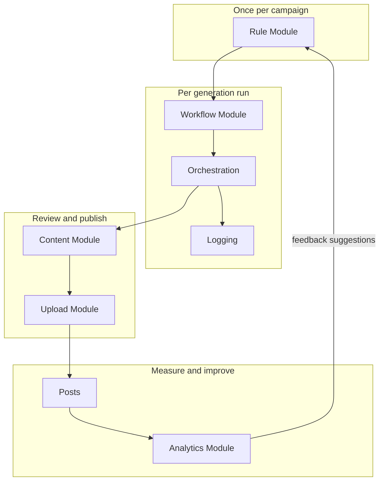
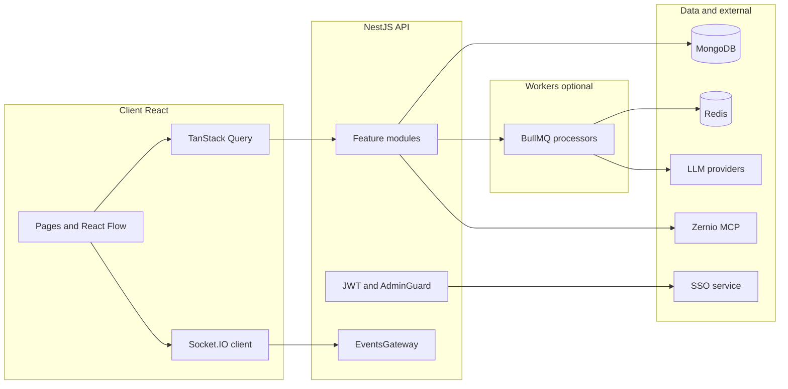
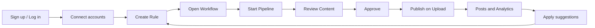

# Mosonic Platform Guide

**Mosonic** is a Thailand-based SaaS platform for AI-driven digital content generation and multi-channel publishing.

This document explains the product concept, end-to-end flow, technology, architecture, how the system behaves, the user interface, user journeys, manuals for customers and admins, and role differences.

For local development setup, see the [root README](../README.md).

---

## Table of contents

1. [Product concept](#1-product-concept)
2. [End-to-end platform flow](#2-end-to-end-platform-flow)
3. [Technology stack](#3-technology-stack)
4. [System architecture](#4-system-architecture)
5. [How the platform handles key concerns](#5-how-the-platform-handles-key-concerns)
6. [Interface map](#6-interface-map)
7. [User journey](#7-user-journey)
8. [User manual (CUSTOMER)](#8-user-manual-customer)
9. [Admin guide (ADMIN)](#9-admin-guide-admin)
10. [Roles comparison](#10-roles-comparison)
11. [Known gaps and roadmap notes](#11-known-gaps-and-roadmap-notes)

---

## 1. Product concept

### What Mosonic is

Mosonic helps businesses produce marketing content — text, images, video, translations — and publish it to social channels (Facebook, Instagram, LinkedIn, YouTube, TikTok) through an **orchestration layer** that controls tone, format, length, keywords, and validation.

The platform does **not** train foundational language models. The proprietary value is in **how** user strategy and prompts are turned into precise, sequential AI instructions, with live progress, review, publishing, and performance feedback.

### Who it is for

- SMEs and startups
- Marketing agencies
- E-commerce teams
- Enterprises running multi-channel campaigns

### Core data concepts

Understanding these separations is essential:

| Concept | Meaning | Lifecycle |
|--------|---------|-----------|
| **Rule** | Campaign strategy: brand voice, audience, goals, channels, keywords | Set up **once per campaign**, reused across many runs |
| **Content prompt** | What to generate **this time** (e.g. “Black Friday 50% off post”) | Provided **per generation run** in the workflow |
| **Workflow** | Template of work nodes (text → image → translate → video, etc.) linked to a rule | Designed per campaign; can be saved as a **template** |
| **Pipeline** | Runtime execution of a workflow for one run | Created when you **start** generation; tracks per-node status and outputs |
| **Content** | Draft package of all node outputs for review | Created when the pipeline completes (or on finalize) |
| **Upload** | Per-channel publish package (preview, schedule, publish) | Created when content is approved (or ensured from content) |
| **Post** | Record of published or scheduled items on platforms | Updated as publishing completes |
| **Analytics** | Performance metrics and rule-improvement suggestions | Pulled per rule/campaign; feeds back into rules |
| **News trigger** | Automated content runs from trending headlines matched to a rule | Configured per rule; cron or manual run starts pipelines |

**Rule vs content prompt:** The rule describes *who the brand is* and *how* to speak. The content prompt describes *what to write about today*. One rule powers many generation runs with different content prompts.

**Workflow vs pipeline:** The workflow stores the **template** (node graph and config). The pipeline stores **runtime state** (status, outputs, retries) for a single execution.

---

## 2. End-to-end platform flow

The platform is built as **seven interconnected modules** that move content from strategy → generation → review → publishing → measurement → improvement.



### Module summary

| # | Module | Purpose |
|---|--------|---------|
| 1 | **Rule** | Extract and store campaign strategy as structured JSON |
| 2 | **Workflow** | Build the node pipeline; combine rule + content prompt |
| 3 | **Orchestration** | Run nodes sequentially (or as a DAG); pass context forward |
| 4 | **Logging** | Real-time visibility of generation (Socket + optional DB logs) |
| 5 | **Content** | Review, edit, rerun nodes, approve or reject drafts |
| 6 | **Upload** | Channel previews, schedule or publish via Zernio MCP |
| 7 | **Analytics** | Pull metrics, dashboards, auto-suggest rule improvements |

### UI and API mapping

| Module | Primary screens | Key API prefixes |
|--------|-----------------|------------------|
| Rule | `/rules` | `POST /rules/extract`, `PATCH /rules/:ruleId` |
| Workflow | `/workflows`, `/workflow/:ruleId` | `POST /workflow/generate`, node CRUD |
| Orchestration | Workflow page, `/pipelines` | `POST /pipeline/start`, retry/skip/cancel |
| Logging | Live on workflow (Socket); `/logs` (stub page) | `GET /pipeline/:id/timeline`, Socket `node:*` |
| Content | `/content`, `/content/:contentId` | `POST /contents/:id/approve`, `rerun-node` |
| Upload | `/upload/:uploadId` | `POST /upload/:id/publish`, Zernio `/zernio/*` |
| Analytics | `/analytics`, `/analytics/:ruleId` | `POST /analytics/pull/:ruleId`, suggestions apply/reject |
| Posts | `/posts` | `GET /posts`, bulk publish/retry |
| Cost | `/cost`, `/cost/budget` | `GET /cost/dashboard`, `PUT /cost/budget` |
| Campaign | (API + schedules) | `/campaign/schedules/*`, `/campaign/autonomy/*` |
| News trigger | `/rules/:ruleId/news-trigger` | `GET/PUT /rules/:ruleId/news-trigger`, `POST .../run` |

### Typical pipeline context flow

```
Content prompt + JSON Rule
  → [Text generation] (locked first node)
  → [Image / Translation / Video / …] (each receives prior outputs)
  → Final content package → Content module
```

Node types supported in the engine include: `keyword_planner`, `text_generation`, `image_generation`, `video_generation`, `translation`, `transcription`, `summarization`, `branch`, `adapt`, `merge`, `intelligence`. Text generation is the anchor node; the workflow canvas enforces it as the starting point.

---

## 3. Technology stack

### Frontend (`client/`)

| Layer | Technology |
|-------|------------|
| Framework | React 19 |
| Build | Vite |
| Language | TypeScript |
| Routing | React Router |
| Server state | TanStack Query |
| Client state | Zustand (auth tokens + user profile only) |
| Real-time | Socket.IO client |
| Workflow UI | React Flow (`@xyflow/react`) |
| UI kit | shadcn/ui, Tailwind, Framer Motion |
| Charts | Recharts |
| i18n | i18next + react-i18next (English, Thai, Simplified Chinese) |
| HTTP | Axios with JWT refresh interceptor |

**Client environment:** `VITE_API_BASE_URL` — base URL for REST and Socket.IO (e.g. `http://localhost:3000`).

### Backend (`server/`)

| Layer | Technology |
|-------|------------|
| Framework | NestJS |
| Database | MongoDB via Mongoose |
| Queue | BullMQ on Redis |
| Scheduling | `@nestjs/schedule` (cron jobs) |
| AI | LangChain + provider SDKs (OpenAI, Anthropic, Google, Groq, Ollama) |
| Real-time | Socket.IO gateway |
| API docs | Swagger at `/docs` |
| Auth | External SSO (JWT); local `users` collection for roles and tenancy |

### Infrastructure and integrations

| Component | Role |
|-----------|------|
| **MongoDB** | Rules, workflows, pipelines, content, uploads, posts, analytics, costs, users, webhooks, etc. |
| **Redis** | BullMQ job queues; optional `PIPELINE_EVENTS_BRIDGE` pub/sub for Socket events |
| **SSO service** | Login, signup, OTP, token refresh (`/auth/*` proxied) |
| **Zernio** | OAuth for social accounts; MCP tools for publish and analytics pull |
| **NewsData.io** | Headline fetch for news trigger automation (`NEWSDATA_API_KEY`) |
| **File service** | Optional external service for media storage (`FILE_SERVICE_URL`) |

### LLM providers

Default provider: `LLM_PROVIDER` in `server/.env`. Per-node `config.provider` can override.

| Provider | Chat | Image | Video | Transcription | Vision |
|----------|------|-------|-------|---------------|--------|
| OpenAI | Yes | Yes | Yes | Yes | Yes |
| Anthropic | Yes | No | No | No | No |
| Google | Yes | No | No | No | No |
| Groq | Yes | Yes | Yes | Yes | Yes |
| Ollama | Yes | No | No | No | No |

Image and video generation require a provider that supports those capabilities; the server validates before calling the model.

---

## 4. System architecture

### Monorepo layout

```text
neutral-tex/
├── client/     # React SPA
├── server/     # NestJS API + orchestration
└── docs/       # Product documentation (this guide)
```

### High-level diagram



### Backend modules (canonical wiring)

From `server/src/app.module.ts`:

- **Core product:** `rule`, `workflow`, `pipeline`, `orchestration`, `content`, `upload`, `post`, `analytics`, `logging`, `events`, `llm`, `nodes`, `preprocessing`
- **Platform:** `auth`, `users`, `admin`, `cost`, `campaign`, `dashboard`, `news-trigger`
- **Integrations:** `mcp`, `webhook`, `integrations`

A separate **worker** entry (`WorkerModule`) can run Bull processors without the full HTTP app when `RUN_WORKERS_IN_API=false`.

### Multi-tenancy and roles

- Every customer-owned document is scoped by `userId`.
- **`CUSTOMER`** (default): queries filtered to the authenticated user’s `userId`.
- **`ADMIN`**: no `userId` filter; can see all tenants including legacy rows without `userId`.

Authentication uses HttpOnly cookies set by the Nest BFF after SSO login (SPA never sees tokens). `JwtAuthGuard` accepts Bearer or the access cookie, then upserts a local user on each request. `AdminGuard` requires `localUser.role === 'ADMIN'`.

### Pipeline execution modes

Controlled by environment variables (see `server/.env.example`):

| Variable | Effect |
|----------|--------|
| `ORCHESTRATION_USE_QUEUE=true` | BullMQ DAG execution (recommended) |
| `ORCHESTRATION_USE_GRAPH=true` | Branch lanes, A/B variants, merge nodes |
| `RUN_WORKERS_IN_API=true` | Process queue jobs inside the API process |
| `PIPELINE_EVENTS_BRIDGE=true` | Workers publish Socket events via Redis when API and workers are split |
| `LANE_SCOPED_PAUSE` | Pause individual branch lanes on failure |
| `CAMPAIGN_AUTONOMY_ENABLED` | Auto-publish when policy allows |
| `NEWSDATA_API_KEY` | NewsData.io API key for news trigger headline fetch |
| `NEWS_TRIGGER_CONCURRENCY` | BullMQ worker concurrency for the `news_trigger` queue |

**Queue path (default):**

1. `POST /pipeline/start` loads workflow + rule + nodes.
2. Graph is materialized (dependencies, lanes).
3. A `pipelines` document is created with status `running`.
4. Root nodes are enqueued on BullMQ; as each completes, dependents are enqueued.
5. On full completion: outputs merged → `contents` created → `uploads` draft created → `pipeline:completed` emitted.

**Failure handling:** Up to 3 retries per node; then pipeline `paused`. User can retry node, skip node, skip lane, resume lane, cancel, or replan.

### MongoDB collections (overview)

| Collection | Purpose |
|------------|---------|
| `users` | Local identity, role, Zernio account refs |
| `rules` | Campaign strategy JSON, versions |
| `workflows` | Workflow metadata, edges, versions |
| `workflow_nodes` | Node definitions (type, config, prompts) |
| `pipelines` | Runtime execution per run |
| `pipeline_logs` | Structured logs (TTL via `expiresAt`) |
| `contents` | Drafts, versions, outputs, approval status |
| `uploads` | Per-channel publish state |
| `posts` | Published post tracking |
| `analytics` | Metrics + feedback suggestions |
| `campaign_schedules` | Scheduled generation |
| `campaign_autonomy_policies` | Auto-publish rules |
| `cost_entries`, `budget_settings` | Spend tracking and limits |
| `integration_api_keys`, `webhook_*` | API keys and outbound webhooks |
| `news_trigger_logs` | News trigger run history (articles, relevance, pipeline refs) |

---

## 5. How the platform handles key concerns

### Rule extraction

1. User submits strategy as text, file (PDF/DOCX/TXT), or URL.
2. `PreprocessingModule` ingests and normalizes input (URL safety checks for scraping).
3. LLM extracts structured JSON (brand, audience, campaign, channels, guidelines).
4. Progress streams on Socket room `rule_{ruleId}`: `rule:started`, `rule:reading_input`, `rule:input_processed`, `rule:streaming`, `rule:completed`, `rule:failed`.
5. User reviews and confirms; versions are stored for rollback.

If no input is provided, the system can generate a baseline rule so workflows are never blocked.

### Workflow building

- **AI path:** `POST /workflow/generate` suggests nodes from the rule; progress on `workflow_{workflowId}`.
- **Manual path:** React Flow canvas at `/workflow/:ruleId` — drag, reorder, configure nodes.
- **Templates:** Save workflow as template; apply template to another rule.
- Text generation remains the locked entry node.

### Pipeline orchestration

Each node receives:

- JSON rule (plus optional analytics overlay / learnings)
- Content prompt for the run
- User prompt on the node (optional)
- Outputs from all ancestor nodes in the DAG

`NodeExecutor` routes to type-specific services in `NodesModule`, all using `LlmService` with capability checks.

### Live visibility (Socket.IO)

Clients join rooms before navigation so events are not missed:

| Room | Pattern | Used for |
|------|---------|----------|
| Pipeline | `pipeline:{pipelineId}` | Node and pipeline lifecycle |
| Rule | `rule_{ruleId}` | Rule extraction |
| Workflow | `workflow_{workflowId}` | Workflow AI generation |
| Content | `content_{contentId}` | Approval, node re-run |
| Analytics | `analytics_{ruleId}` | Metric pull, suggestions |
| Upload | `upload_{uploadId}` | Publish status |
| User | `user:{userId}` | In-app notifications (`notification` event) |

Gateway handlers: `join` / `leave` with `{ room }`.

**Representative server events:**

| Domain | Events |
|--------|--------|
| Pipeline | `pipeline:started`, `pipeline:completed`, `pipeline:failed`, `pipeline:paused`, `pipeline:lane_paused` |
| Node | `node:started`, `node:streaming`, `node:retrying`, `node:processing`, `node:completed`, `node:failed_final` |
| Cost | `cost:monthly_warning`, `cost:monthly_limit_hit`, `cost:run_limit_hit` |
| Rule | `rule:started`, `rule:reading_input`, `rule:input_processed`, `rule:streaming`, `rule:completed`, `rule:failed` |
| Workflow | `workflow:started`, `workflow:generating`, `workflow:completed`, `workflow:failed` |
| Content | `content:step_approved`, `content:approval_required`, `content:approved`, `content:rejected`, `node:rerun_completed` |
| Analytics | `analytics:pull_started`, `analytics:pull_completed`, `analytics:pull_failed`, `analytics:suggestion_ready` |
| Upload | `upload:started`, `upload:updated`, `upload:completed`, `upload:scheduled`, `upload:failed`, `upload:all_completed` |
| News trigger | `news:run_update` (rule room) |
| Notifications | `notification` (user room; pipeline, news, cost, etc.) |
| Pipeline logs | `pipeline:log` (when persisted to DB) |

### Content lifecycle

- Pipeline completion creates a **draft** with version 1.
- **Text / translated text:** editable inline in the UI.
- **Image / video:** remove AI output and upload replacement (no in-app editing in v1).
- **Re-run node:** adjust node prompt, re-execute with same rule + context; prior output kept in version history.
- **Approve** → triggers upload draft (or navigates to upload).
- **Reject** → stays in draft for further edits.
- Draft versions are retained indefinitely.

### Publishing (Upload + Zernio)

1. User connects channels at `/settings/accounts` (Zernio OAuth).
2. Upload page shows per-channel previews adapted to channel constraints (length, aspect ratio, video limits).
3. User publishes immediately or schedules per channel.
4. `UploadModule` calls Zernio MCP/REST; status tracked per channel: `pending`, `scheduled`, `published`, `failed`.
5. Failures can be retried; webhooks from Zernio update state.

**Phase 1 channel constraints (from product spec):**

| Channel | Max text | Image ratio | Video |
|---------|----------|-------------|-------|
| Facebook | 63,206 | 1.91:1 | Yes |
| Instagram | 2,200 | 1:1 or 4:5 | Yes (60s) |
| LinkedIn | 3,000 | 1.91:1 | Yes |
| YouTube | — | 16:9 | Yes |
| TikTok | 2,200 | 9:16 | Yes (60s) |

### Analytics and feedback loop

- Metrics pulled manually (`POST /analytics/pull/:ruleId`) or on a weekly cron (when configured).
- Data aggregated at **rule (campaign)** level across all content under that rule.
- System generates **suggestions** (e.g. tone, keywords, channel priority).
- User **applies** or **rejects** suggestions; apply patches the rule for future runs.

### Cost control

- Each LLM call can record cost in `cost_entries`.
- Users set budgets at `/cost/budget`.
- When limits are approached or hit, Socket warnings are emitted on the active pipeline room.

### Campaign automation

- **Schedules:** upcoming runs per rule (`/campaign/schedules/*`).
- **Autonomy policies:** optional auto-publish when content meets policy (`CAMPAIGN_AUTONOMY_ENABLED`).

### News trigger automation

News trigger turns trending headlines into generation runs without manual content prompts. Settings live on each rule and are edited at `/rules/:ruleId/news-trigger` (also reachable from **News auto-generate** on the Rules page).

**Configuration (stored on `rule.newsTrigger`):**

| Setting | Purpose |
|---------|---------|
| `enabled` | Turn scheduled news runs on or off |
| `schedule` | `daily` (08:00 only) or `twice_daily` (08:00 and 18:00, server local time) |
| `country`, `language`, `category` | NewsData.io source filters |
| `keywords` | Extra relevance keywords (merged with rule campaign keywords) |
| `minRelevanceScore` | LLM relevance threshold (60–90; default 70) |
| `maxPostsPerDay` | Cap pipelines started per rule per day (1–3) |
| `autoApprove` | When enabled, auto-approve content after a news-triggered pipeline completes |

**Run flow:**

1. **Scheduled:** cron at 08:00 and 18:00 groups enabled rules by country/language/category, fetches headlines via NewsData.io, and enqueues BullMQ jobs on the `news_trigger` queue.
2. **Manual:** `POST /rules/:ruleId/news-trigger/run` (202) enqueues a single-rule job; progress streams on the rule Socket room as `news:run_update`.
3. For each candidate article, the processor scores relevance against the rule (LLM), picks the best match, builds a **content prompt** from the headline, and calls `orchestration.startPipeline` using the rule’s latest **ready workflow**.
4. Pipeline metadata includes `source: 'news'` and article details. User notifications (`news.pipeline_started`, `news.run_completed`, `news.content_ready`) appear in the topbar bell and optional browser alerts.
5. If `autoApprove` is on, content is approved automatically after generation; otherwise the user reviews at `/content/:contentId` as usual.

**Requirements:** `NEWSDATA_API_KEY` in `server/.env`, a saved workflow for the rule, and (when `RUN_WORKERS_IN_API=false`) a worker process that registers `NewsTriggerProcessor`.

**API:** `GET/PUT /rules/:ruleId/news-trigger`, `POST /rules/:ruleId/news-trigger/run`, `GET .../runs/latest`, `GET .../runs/:runId`.

### In-app notifications

The topbar **notification bell** subscribes to Socket room `user:{userId}` and receives `notification` events for pipeline completion, news trigger activity, cost warnings, and related actions. Optional browser push alerts are supported when permitted. The `NotificationProvider` in `AppLayout` also shows toasts for background events.

### Authentication

- Login/signup/refresh proxied to SSO; tokens stored client-side (Zustand, persisted).
- `GET /auth/me` loads profile into user store.
- Development: `SSO_AUTH_DISABLED=true` with `DEV_IMPERSONATE_AUTH_SERVER_USER_ID`.
- Admin bootstrap: `ADMIN_BOOTSTRAP_AUTH_SERVER_USER_IDS`, `DEFAULT_ADMIN_*` env vars.

### External integrations

- **API keys:** `POST /integrations/v1/api-keys` (JWT) mints a key (`ntx_...`). Use `X-API-Key` on:
  - `POST /integrations/v1/pipelines/start` (scope `pipeline:start`)
  - `/integrations/v1/competition-event/*` (scope `competition-event`; JWT also accepted for manual testing)
- Competition-event generate/save/get-by-ref run as the **key owner**. Provision upserts a Mosonic user from the request body (`name`, `email`, `username`, optional `authServerUserId`) and does not update the key owner.
- **Outbound webhooks:** subscribe to pipeline lifecycle events.
- **Inbound:** `POST /webhooks/zernio` for platform callbacks.

---

## 6. Interface map

### Layouts

| Layout | Routes | Description |
|--------|--------|-------------|
| Public | `/` | Landing: quick prompt → generate workflow |
| Guest auth | `/login`, `/signup`, `/forgot-password`, `/verify-otp`, `/reset-password` | No sidebar |
| App | Protected routes under `AppLayout` | Sidebar + topbar |
| Admin | `/admin/*` inside `AdminRoute` | Secondary admin nav |

### Sidebar navigation (authenticated)

From `client/src/components/core/sidebar.tsx`:

- Home (`/`)
- Dashboard
- Rules (also highlights when on `/workflow/:ruleId`)
- Workflows
- Pipelines
- Content
- Posts
- Analytics (badge when suggestions pending)
- Costs
- Account settings
- **Admin** (visible only when `role === ADMIN`)

**Routed but not in sidebar:** `/rules/:ruleId/news-trigger`, `/workflow/:ruleId`, `/upload`, `/upload/:uploadId`, `/run`, `/logs`, `/components`, `/cost/budget`, `/contents/:contentId` (alias).

### Route catalog

#### Public and authentication

| Route | Purpose |
|-------|---------|
| `/` | Landing; fast-path content generation |
| `/login` | Sign in; supports `?next=` redirect (e.g. admin dashboard) |
| `/signup` | Register |
| `/forgot-password` | Request password reset |
| `/verify-otp` | OTP verification |
| `/reset-password` | Set new password |
| `/admin/login` | Redirects to `/login?next=/admin/dashboard` |

#### Customer (protected)

| Route | Purpose |
|-------|---------|
| `/dashboard` | Stats, charts, quick links |
| `/rules` | Create and manage campaign rules |
| `/rules/:ruleId/news-trigger` | News trigger settings, manual run, live run status |
| `/workflows` | List saved workflows |
| `/workflow/:ruleId` | **Main workspace:** canvas, start pipeline, live progress |
| `/pipelines` | Pipeline run history and actions |
| `/run` | Mock live-run UI (not connected to API) |
| `/content` | Content library |
| `/content/:contentId` | Review, edit, approve, rerun nodes |
| `/contents/:contentId` | Alias for content detail (same page) |
| `/upload` | Upload list / entry when no ID in URL |
| `/upload/:uploadId` | Channel preview and publishing |
| `/posts` | Published and scheduled posts |
| `/settings/accounts` | Connect social accounts (Zernio) |
| `/analytics` | Analytics overview per rule |
| `/analytics/:ruleId` | Campaign metrics and suggestions |
| `/cost` | AI spend dashboard |
| `/cost/budget` | Budget configuration |
| `/logs` | Placeholder (“coming soon”) |
| `/components` | Internal UI component gallery |

#### Admin (protected + `AdminRoute`)

| Route | Purpose |
|-------|---------|
| `/admin/dashboard` | Platform KPIs and trends |
| `/admin/users` | User list and search |
| `/admin/users/:userId` | User detail; suspend, role, status |
| `/admin/cost` | Cross-tenant cost summary |
| `/admin/content` | Browse all users’ content |
| `/admin/content/:contentId` | Inspect any content record |

### Client data flow

```
UI → shared/queries (TanStack Query) → shared/services → api-client (Axios)
UI → shared/socket/* → Socket.IO (same base URL as API)
```

On 401, the client refreshes the access token via `/auth/refresh` once, then retries or logs out.

### API surface (summary)

Swagger at `http://localhost:3000/docs` when the server is running. Major groups:

- `auth`, `rules`, `workflow`, `pipeline`, `contents`, `upload`, `posts`, `analytics`, `cost`, `dashboard`, `campaign`, `zernio`, `mcp`, `integrations/v1`, `webhooks`, `admin/*` (news trigger settings and runs are under `rules/:ruleId/news-trigger`)

---

## 7. User journey

### First-time customer journey



1. **Register / log in** at `/login` or `/signup`.
2. **Connect social accounts** at `/settings/accounts` (required before publishing).
3. **Create a rule** at `/rules` — provide brand strategy → review extracted JSON → save.
4. **Open workflow** at `/workflow/:ruleId` — AI-generate or build node graph; enter **content prompt**.
5. **Start pipeline** — watch live node events on the workflow page; track history on `/pipelines`.
6. **Review content** at `/content/:contentId` — edit text, rerun nodes if needed.
7. **Approve** — moves toward publish-ready state; app may navigate to upload.
8. **Publish** at `/upload/:uploadId` — preview per channel; publish now or schedule.
9. **Monitor** via `/posts` and `/analytics/:ruleId`.
10. **Improve** — accept analytics suggestions to update the rule; run again.

### Fast path (experienced user)

1. On home `/`, enter a content prompt.
2. Select or create a rule context.
3. App calls `POST /workflow/generate` and navigates to `/workflow/:ruleId` with generation state.
4. Start pipeline when the graph is ready.

### Returning user

- Reuse existing **rules** and **workflow templates**.
- Only change the **content prompt** per run (or enable **news trigger** for hands-off runs).
- Check **pending analytics suggestions** (sidebar badge on Analytics).
- Manage **cost budget** if spend limits matter.
- Watch the **notification bell** for completed news-triggered pipelines and publish-ready content.

### News-driven journey (optional)

1. Create a rule and build a workflow as usual.
2. Open `/rules/:ruleId/news-trigger` — configure country, language, keywords, and schedule.
3. Enable news trigger or click **Run now** for a manual fetch.
4. When a headline matches, a pipeline starts automatically; follow progress via notifications or `/pipelines`.
5. Review content (unless **auto-approve** is enabled), then publish from upload.

---

## 8. User manual (CUSTOMER)

This section describes what a **customer** (`CUSTOMER` role) can do in the UI.

### Rules (`/rules`)

**What you can do:**

- Create a rule from free text, uploaded document, or URL.
- Run AI extraction and watch live progress.
- Edit fields in a structured form or visual graph.
- Save, duplicate, archive, and delete rules.
- View version history and roll back.
- See pending analytics-driven improvement suggestions (also on analytics pages).

**How:**

1. Click create rule; choose input type.
2. Wait for extraction to complete (Socket progress).
3. Review JSON summary; adjust brand, audience, channels, keywords.
4. Confirm and save.

**News auto-generate:** From the Rules toolbar, open **News auto-generate** (or navigate to `/rules/:ruleId/news-trigger`) to configure automated headline-driven runs. See [News trigger automation](#news-trigger-automation) above.

### News trigger (`/rules/:ruleId/news-trigger`)

**What you can do:**

- Enable or disable scheduled news runs (`daily` or `twice_daily`).
- Set news source country, language, and category.
- Add keyword tags for tighter relevance matching.
- Set minimum relevance score and max posts per day.
- Choose draft review vs **auto-approve** after generation.
- Trigger a **manual run** and watch live status (`news:run_update`).
- Jump to the started pipeline from the last-run panel.

**How:**

1. Select a rule on `/rules`, then click **News auto-generate**.
2. Configure settings and save.
3. Click **Run now** to test, or wait for the scheduled cron (08:00 / 18:00 server time).
4. Ensure the rule has a ready workflow — otherwise runs skip with “no ready workflow”.
5. Review generated content at `/content` unless auto-approve is enabled.

### Workflows (`/workflows`, `/workflow/:ruleId`)

**What you can do:**

- List workflows tied to campaigns.
- Open the canvas for a rule.
- AI-generate a suggested pipeline from the rule.
- Add, reorder, and configure nodes (text, image, video, translation, branch, etc.).
- Set optional per-node prompts.
- Save the workflow; save as reusable template; apply a template.
- Enter the **content prompt** for this run.
- **Start pipeline** from the toolbar.

**How:**

1. From Rules or Workflows, open `/workflow/:ruleId`.
2. Generate or drag nodes on the React Flow canvas.
3. Configure each node in the properties panel.
4. Enter content prompt; click start.
5. Stay on the page for live progress or open `/pipelines` for history.

### Pipelines (`/pipelines`, workflow page)

**What you can do:**

- View all runs with status filters.
- Open a running or completed pipeline.
- Retry a failed node, skip node or lane, cancel, resume lane, replan (when paused).
- View timeline (`GET /pipeline/:id/timeline`) when logs exist.

### Content (`/content`, `/content/:contentId`)

**What you can do:**

- Browse drafts, approved, and rejected items.
- Open a draft; see outputs per node type.
- Edit text inline; replace images/videos with uploads.
- Re-run a single node (optionally change that node’s prompt).
- Approve or reject.
- Browse version history.

**Approve** creates or links an upload package for publishing.

### Upload (`/upload/:uploadId`)

**What you can do:**

- Preview how content appears on each channel.
- Adjust per-channel composition (drag-and-drop layout where supported).
- Publish immediately or schedule.
- Retry failed channels.
- Upload media assets.

Reached from content approval, pipeline completion navigation, or content cards.

### Posts (`/posts`)

**What you can do:**

- View published and scheduled posts.
- Bulk publish, cancel, delete, or schedule.
- Retry failed publishes per post.

### Analytics (`/analytics`, `/analytics/:ruleId`)

**What you can do:**

- See all rules with analytics summaries.
- Trigger a manual metrics pull.
- View charts: views, engagement, CTR, conversions, per-channel breakdown.
- Review AI **suggestions** for rule improvements.
- **Apply** or **reject** each suggestion.

Applying updates the rule for future content generation.

### Cost (`/cost`, `/cost/budget`)

**What you can do:**

- View AI spend over time and per pipeline.
- Set monthly or per-run budget limits.
- Receive warnings when approaching limits (also during pipeline runs).

### Dashboard (`/dashboard`)

**What you can do:**

- See high-level stats, recent activity, engagement charts.
- Use quick links into rules, workflows, and content.

### Account settings (`/settings/accounts`)

**What you can do:**

- Connect or disconnect Facebook, Instagram, LinkedIn, YouTube, and TikTok via Zernio OAuth.
- Sync account list after connecting.

Publishing and analytics depend on connected accounts.

### Notifications (topbar bell)

**What you can do:**

- See in-app alerts for pipeline completion, news trigger runs, and related actions.
- Click notification actions to open content, pipelines, or upload pages.
- Optionally enable browser push alerts (when supported and permitted).

---

## 9. Admin guide (ADMIN)

Admins use the same login at `/login` (optional `?next=/admin/dashboard`). The **Admin** item appears in the sidebar only when `role === ADMIN`.

Admin pages use a dedicated **AdminLayout** (Dashboard, Users, Cost, Content) with a link back to the main app.

### What admins are for

Admins **operate the platform**: user lifecycle, cross-tenant visibility, cost oversight, and operational recovery. They do **not** use admin pages as a replacement for the customer content-creation flow.

### Admin dashboard (`/admin/dashboard`)

**Capabilities:**

- Platform overview KPIs.
- User growth charts.
- Pipeline volume and success trends.
- Cost trends across tenants.
- Node-type usage breakdown.
- Channel distribution.
- Pipeline SLO metrics.

**API:** `GET /admin/dashboard/overview`, `user-growth`, `pipeline-trend`, `cost-trend`, `node-types`, `channels`, `pipeline-slo`.

### User management (`/admin/users`, `/admin/users/:userId`)

**Capabilities:**

- Search and list all users.
- View user detail: profile, status, role.
- **Suspend** and **reactivate** accounts.
- Change **role** (`CUSTOMER` / `ADMIN`) and status.
- **Create** users (provisioned via SSO).
- **Delete** users.

**API:** `admin/users` REST endpoints.

### Content inspection (`/admin/content`, `/admin/content/:contentId`)

**Capabilities:**

- Browse content across all tenants.
- Filter and search.
- Open read-only detail for support and moderation.

**API:** `admin/content`.

### Platform cost (`/admin/cost`)

**Capabilities:**

- Cross-tenant cost summary.
- Month-over-month comparison.

**API:** `admin/cost/summary`, `admin/cost/month-over-month`.

### Operations (API; limited UI)

**Capabilities:**

- **Replay failed queue jobs** from the dead-letter queue: `POST /admin/pipeline/jobs/replay` (admin role checked in handler).

### MCP platform setup (server; admin-only routes)

**Capabilities:**

- Zernio MCP setup and connection test.
- List available MCP tools.
- Test post to connected accounts.

**API:** `GET /mcp/setup`, `/mcp/test-post`, `/mcp/tools` (require `AdminGuard`).

Customers use `/settings/accounts` and `/zernio/*` for their own OAuth connections; platform-level MCP setup is admin-only.

---

## 10. Roles comparison

| Capability | CUSTOMER | ADMIN |
|------------|----------|-------|
| Create and run own rules/workflows/pipelines | Yes | Yes |
| Own content, uploads, posts | Yes | Yes |
| View other users’ data | No | Yes |
| `/admin/*` UI | No | Yes |
| Suspend / reactivate users | No | Yes |
| Change user roles | No | Yes |
| Cross-tenant cost dashboard | No | Yes |
| Browse all content | No | Yes |
| MCP platform setup (`/mcp/setup`, etc.) | No | Yes |
| DLQ job replay | No | Yes |
| Connect own social accounts (Zernio) | Yes | Yes |
| Configure news trigger on own rules | Yes | Yes |

Both roles use the same SSO login. Admin access is determined by the `role` field on the local `users` document (bootstrapped via env or updated in admin UI).

---

## 11. Known gaps and roadmap notes

These are current implementation limitations worth knowing:

| Area | Status |
|------|--------|
| `/logs` page | Placeholder UI (“coming soon”); links to dashboard |
| `/run` page | Mock data; not wired to live pipeline API |
| `pipeline_logs` persistence | Partial — `LoggingService.appendLog` is used for some video-generation milestones (`media-node-completion.service`); most node lifecycle events are Socket-only, not yet written to MongoDB |
| Logging module vs product spec | Spec describes 90-day TTL logs for all nodes; DB TTL is supported, but full orchestration coverage is incomplete |
| Orphan lazy routes | `workflow-prompt.tsx`, `workflow-generate.tsx` exist but are not registered in the router (logic merged into `workflow.tsx`) |
| News trigger | Requires `NEWSDATA_API_KEY` and a ready workflow per rule; cron uses server local timezone |

For API details beyond this guide, use Swagger at `/docs` on a running server instance.

---

## Related files

| Document | Purpose |
|----------|---------|
| [README.md](../README.md) | Monorepo quick start and dev commands |
| [.cursor/rules/Project-flow-and-funtionalities.mdc](../.cursor/rules/Project-flow-and-funtionalities.mdc) | Canonical product specification |
| `server/src/app.module.ts` | Module wiring |
| `client/src/app/routes/router.tsx` | Frontend routes |
| `server/src/news-trigger/` | News trigger queue, cron, and processor |
| `server/.env.example` | Environment reference |
