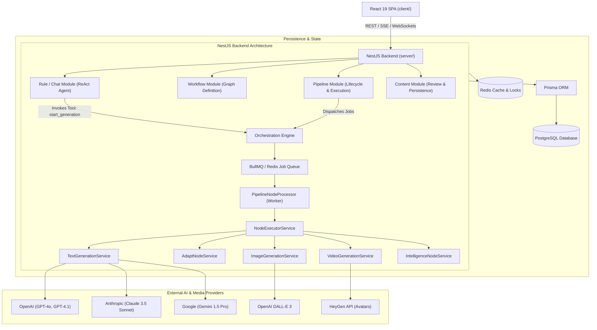

# 01. System Architecture & Technical Overview

**Author:** LCN Alvin  
**Document Version:** 1.0  
**Last Updated:** 2026-11-05  
**Document Status:** Audit

## 1. Executive Summary

Mosonic is an enterprise AI marketing content generation and orchestration SaaS platform. It automates campaign strategy development, multi-channel copy generation, visual asset generation (images, avatars, video), human review, multi-channel publishing (Instagram, Facebook, LinkedIn, YouTube, TikTok, RedNote), and closed-loop performance analytics.

This audit investigates the end-to-end architecture of Mosonic to understand why user-specified content templates and structured output formats (such as 7-part promotional Instagram templates) are not consistently preserved during AI generation.

---

## 2. Technology Stack

The platform is structured as an independently managed polyglot repository without a root workspace configuration:

| Component | Technology | Primary Role |
| :--- | :--- | :--- |
| **Backend Core** | NestJS 11, TypeScript, Express, BullMQ, Redis, Prisma ORM, PostgreSQL | API gateway, pipeline orchestration, AI node execution, chat ReAct agent, state persistence |
| **Frontend Client** | React 19, Vite, TypeScript, Tailwind CSS, Lucide icons, Framer Motion, TanStack Query | Single-page application (SPA), workflow canvas, chat interface, draft review/approval UI |
| **Orchestration / Queue** | Redis (ioredis) + BullMQ (`@nestjs/bullmq`) | Job scheduling, async node execution, per-tenant worker queues, failure retries |
| **AI Orchestration** | LangChain Core (`@langchain/core`), LangChain OpenAI, Anthropic, Google GenAI | Model abstraction, prompt chaining, tool calling, streaming execution |
| **Database & Cache** | PostgreSQL (relational storage via Prisma), Redis (runtime queue, distributed turn locks) | Domain entities (Content, Pipeline, Rule, Workflow), ephemeral job state |
| **External Video/Media** | HeyGen API, OpenAI Sora / DALL-E, File Service Proxy | Avatar synthesis, cinematic video rendering, media asset storage |
| **Ancillary Microservices** | Spring Boot 4.1 (`payment/`, `scheduler/`), FastAPI (`faq/`) | Payment credit catalog/proxy, delayed cron jobs, FAQ embedding engine |

---

## 3. High-Level System Architecture

---

## 4. Key Application Modules & Source Code Layout

### Backend (`server/src/`)
- `llm/` ([`llm.service.ts`](file:///server/src/llm/llm.service.ts)): Centralized provider abstraction for OpenAI, Anthropic, Google GenAI, Groq, and Ollama. Manages token context limits, model selection, temperature, and API keys.
- `rule/` ([`rule.service.ts`](file:///server/src/rule/rule.service.ts), `chat/`): Implements the brand brain.
  - `chat/chat-session.service.ts`: Runs multi-turn conversation ReAct agents.
  - `chat/react-chat-instructions.ts`: System instructions governing the chat agent.
  - `tools/start-generation.tool.ts`: LangChain tool that converts chat intentions into pipeline execution runs.
  - `rule-context-builder.util.ts`: Builds system prompts from structured brand profiles, target audience, and guidelines.
- `nodes/` ([`nodes.module.ts`](file:///server/src/nodes/nodes.module.ts), `services/`): Individual step implementations.
  - `services/text-generation.service.ts`: Core copywriter node.
  - `services/adapt-node.service.ts`: Channel adaptation node (Instagram, Facebook, TikTok, etc.).
  - `services/generated-text-guardrails.util.ts`: Regex-based post-sanitization.
  - `services/adapt-channel-guardrails.util.ts`: Configurable channel limits and platform policies (e.g., TikTok photo slideshow title cap of 90 chars in `platform-limits.ts`).
- `orchestration/` ([`orchestration.service.ts`](file:///server/src/orchestration/orchestration.service.ts)):
  - `node-executor.service.ts`: Invokes specific node handlers.
  - `source-pack-builder.service.ts`: Preprocesses user attachments, URLs, and notes.
  - `processors/pipeline-node.processor.ts`: BullMQ worker handling async step execution.
- `pipeline/` ([`pipeline.service.ts`](file:///server/src/pipeline/pipeline.service.ts), `pipeline.repository.ts`):
  - Manages pipeline run instances, tracking status (`pending`, `running`, `completed`, `failed`).
- `content/` ([`content.service.ts`](file:///server/src/content/content.service.ts)):
  - Manages generated drafts, version history, manual overrides, reviews, and approvals.
  - `content-node-output.util.ts`: Flattens multi-node execution outputs into a single content document.

### Frontend (`client/src/`)
- `features/chat/`: Interactive conversational agent UI.
  - `components/chat-composer.tsx`: Prompt input area with file attachments.
  - `components/chat-content-card.tsx`: Inline preview card for generated drafts.
  - `components/dialogs/`: Modal dialogs for approving, editing, checking, and rejecting content.
- `features/workflow/`: Node-based canvas (React Flow) for viewing and editing generation graphs.
  - `components/workflow-flow-canvas.tsx`: Visual graph builder.
  - `components/workflow-node-config-fields.tsx`: Inspector for node settings (model, temperature, format, tone).
- `features/content/`: Dedicated content draft review portal.
  - `pages/content-detail.tsx`: Single-content review and edit screen.
  - `components/content-detail/content-detail-node-card.tsx`: Display card showing generated outputs in raw Textarea fields.
  - `lib/content-display.ts`: Formatting and label helpers.

---

## 5. API Communication & Asynchronous Processing

1. **Client to Server**: React communicates with NestJS via REST endpoints (`/api/v1/`) and WebSocket / Server-Sent Events (SSE) for streaming LLM generation tokens and pipeline status updates.
2. **Turn Locking**: Distributed locking in `chat-turn-lock.service.ts` ensures that users cannot execute concurrent conflicting turns on the same chat session.
3. **Queue Architecture**: Long-running generation jobs are placed onto per-tenant BullMQ Redis queues (`pipeline:node:{tenantId}`).
4. **Result Callback**: Upon pipeline node completion, events are broadcast over Socket.IO rooms (`content:{contentId}` and `pipeline:{pipelineId}`), allowing live reactive UI updates.