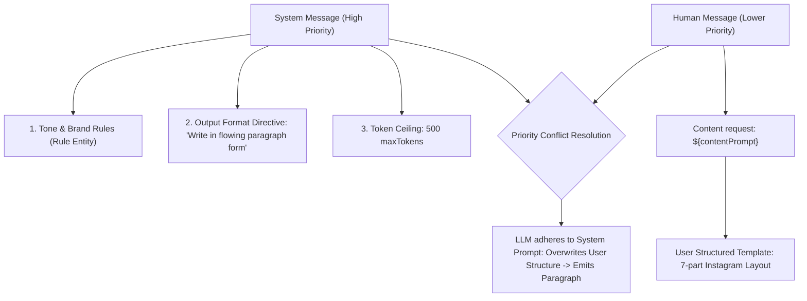
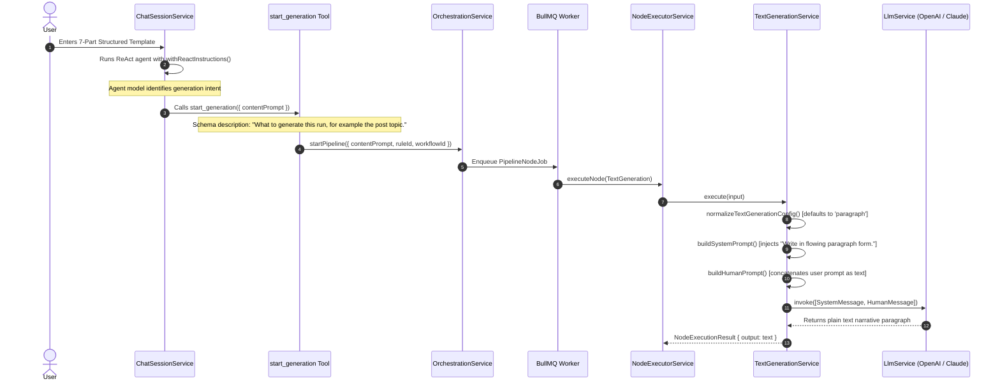

# 02. AI Prompt Management & Instruction Hierarchy

**Author:** LCN Alvin  
**Document Version:** 1.0  
**Last Updated:** 2026-11-05  
**Document Status:** Audit

## 1. Overview of Prompt Architecture

In Mosonic, prompt construction is divided into two distinct execution tiers:
1. **Interactive Conversational Tier (Chat ReAct Agent)**: Guides the user, gathers campaign context, and decides when to trigger generation.
2. **Autonomous Pipeline Execution Tier (Workflow Nodes)**: Executes discrete LLM calls for copywriting, channel adaptation, translation, and image styling.

---

## 2. Prompt Composition Across the Platform

### Tier 1: Chat Agent System Prompt (`ChatSessionService`)

When a user chats with Mosonic, the prompt is dynamically constructed in `server/src/rule/chat/chat-session.service.ts` using `withReactInstructions(buildRuleBrainPrompt(rule, assets, memories))`:

```
+-------------------------------------------------------------------------+
| SYSTEM PROMPT                                                           |
| 1. Rule Brain Prompt (buildRuleBrainPrompt in rule-context-builder.util)|
|    - Brand identity (name, industry, description, tone, voice, CTA)    |
|    - Audience demographics, pain points, interests, language            |
|    - Campaign goals, keywords, hashtags                                 |
|    - Brand restrictions                                                 |
|    - Brand memory / facts (RuleMemory)                                  |
|    - Ready brand asset summaries                                        |
| 2. ReAct Chat Instructions (react-chat-instructions.ts)                 |
|    - Tool enforcement: "You are not a copywriter in this chat. To make  |
|      a post... you MUST call start_generation; never write it yourself."|
|    - Live state is truth                                                |
|    - Output style rules                                                 |
+-------------------------------------------------------------------------+
| CONVERSATION HISTORY                                                    |
| - Up to N past chat turns formatted as AIMessage / HumanMessage         |
+-------------------------------------------------------------------------+
| CURRENT USER MESSAGE                                                    |
| - Text provided by user in ChatComposer                                 |
+-------------------------------------------------------------------------+
```

### Tier 2: Content Generation Prompt (`TextGenerationService`)

When the pipeline runs the `text_generation` node, prompt construction is handled exclusively inside `server/src/nodes/services/text-generation.service.ts`:

```typescript
function buildSystemPrompt(
  rule: Rule,
  config: NormalizedTextConfig,
  previousOutputs?: PreviousOutputs,
): string { ... }

function buildHumanPrompt(
  contentPrompt: string,
  previousOutputs?: PreviousOutputs,
  sourcePackNotes?: string,
): string { ... }
```

The resulting LLM call structure is:

```
[SystemMessage]
- Role definition: "You are a professional content writer..."
- Temporal context: "Today is YYYY-MM-DD..."
- Brand Guidelines: Brand name, Industry, Tone, Voice, CTA
- Audience Guidelines: Pain points, Interests, Age range, Language
- Campaign Guidelines: Goals, Keywords (max 2-3), Hashtags
- Restrictions: rule.brand.brandRestrictions
- Node Voice: config.tone (Professional, Casual, Friendly, Formal, etc.)
- Node Length: config.textLength (Short, Medium, Long)
- Node Output Format (HARDCODED CONSTRAINT):
    "=== OUTPUT FORMAT ===
     Format: paragraph
     Write in flowing paragraph form.
     Maximum length: 500 tokens.
     Do not include any explanation, preamble, or metadata.
     Return only the content itself."
- Intelligence Brief (if web research node ran upstream)

[HumanMessage]
- Content request: ${contentPrompt}
- Target keywords (if keyword planner ran upstream)
- Source attachments / Notes (product facts extracted from files/URLs)
```

---

## 3. The Instruction Hierarchy and Conflict Resolution

When analyzing how conflicting instructions are resolved:



### Why User Templates Are Treated as Contextual Guidance Rather than Mandatory Contracts
1. **Lack of Template Separation**: The user's input is passed as a raw string into `contentPrompt`. The system does not classify or parse whether the user provided a simple topic ("announce our summer shoe sale") or a strict structural template (7-section markdown block).
2. **System Prompt Dominance**: OpenAI and Claude models heavily weight instructions inside `SystemMessage` over requests in `HumanMessage`. Because `SystemMessage` explicitly enforces `Format: paragraph` and `Write in flowing paragraph form`, the model prioritizes the system directive and summarizes the user's template into a single narrative paragraph.
3. **Absence of Few-Shot Formatting Examples**: No examples of structured layouts or section headings are provided in the system prompt.
4. **Token Truncation Pressure**: With `maxTokens` defaulting to `500` (and `NodeSummaryLength.Short` requesting "roughly a few sentences"), multi-section templates containing headers, bullet points, and CTAs naturally get compressed to avoid truncation.

---

## 4. Prompt Execution Flow: Tracing User Input to the Model



---

## 5. Traceable Source References

| Function / Component | File Path | Line Range | Architectural Flaw Identified |
| :--- | :--- | :--- | :--- |
| `buildSystemPrompt` | `server/src/nodes/services/text-generation.service.ts` | lines 68–163 | Injects un-overridable `Write in flowing paragraph form` constraint. |
| `buildHumanPrompt` | `server/src/nodes/services/text-generation.service.ts` | lines 165–183 | Blindly prepends `Content request:` without format parsing or schema framing. |
| `normalizeTextGenerationConfig` | `server/src/nodes/services/text-generation.service.ts` | lines 39–66 | Enforces hard fallback: only supports `Paragraph`, `Bullets`, `Caption`. Defaults to `Paragraph`. |
| `START_GENERATION_SCHEMA` | `server/src/rule/tools/start-generation.tool.ts` | lines 66–77 | Models user prompt as merely a topic string; no field for structural templates or schemas. |
| `REACT_CHAT_INSTRUCTIONS` | `server/src/rule/chat/react-chat-instructions.ts` | lines 2–40 | Forbids chat agent from handling layout; forces single tool call with flattened text. |