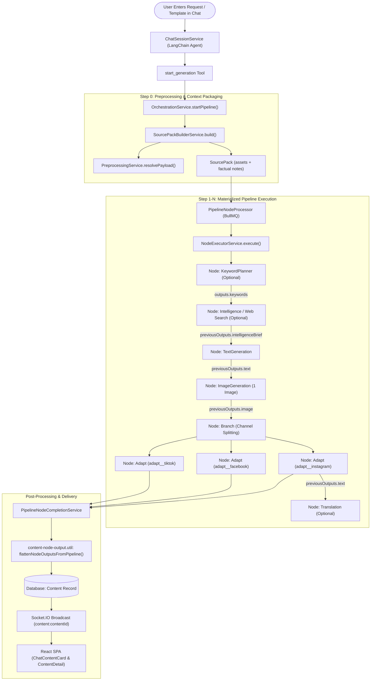

# 03. AI Workflow and Orchestration

**Author:** LCN Alvin  
**Document Version:** 1.0  
**Last Updated:** 2026-11-05  
**Document Status:** Audit

## 1. End-to-End Content Generation Lifecycle

The real content generation workflow in Mosonic operates as a Directed Acyclic Graph (DAG) executed asynchronously by BullMQ workers and orchestrated by `OrchestrationService`.



---

## 2. Stage-by-Stage Component Breakdown

### Stage 1: Request Intake & Chat Turn Execution
- **Responsible Service**: `server/src/rule/chat/chat-session.service.ts` (`ChatSessionService.sendMessage`)
- **Input Data**: Raw user chat input string (e.g. structured Instagram promo template), session ID, rule ID.
- **AI Model**: GPT-4o / Claude 3.5 Sonnet (ReAct chat loop).
- **Output Data**: Tool call `start_generation({ contentPrompt: string, ... })`.
- **Formatting Preservation Status**: **PARTIALLY LOST / RISKY**.
  - The chat instructions in `react-chat-instructions.ts` state: *"Put their topic or bullet list in contentPrompt and call this in the same turn"*.
  - When the model extracts `contentPrompt`, it may compress or paraphrase the input if it interprets it as conversational preamble rather than a literal template contract.

### Stage 2: Pipeline Initialization & SourcePack Preprocessing
- **Responsible Service**: `server/src/orchestration/orchestration.service.ts` (`startPipeline`) & `server/src/orchestration/source-pack-builder.service.ts`
- **Input Data**: `contentPrompt`, uploaded files, URLs, brand rule reference.
- **Output Data**: `Pipeline` database record, `sourcePack` (extracted images, OCR/scraped text, and synthesized run notes via `RUN_SUMMARY_SYSTEM`).
- **Formatting Preservation Status**: **PRESERVED IN PIPELINE RECORD**.
  - `pipeline.contentPrompt` stores the raw string passed from `start_generation`.

### Stage 3: Core Copy Generation (`TextGenerationService`)
- **Responsible Service**: `server/src/nodes/services/text-generation.service.ts` (`TextGenerationService.execute`)
- **Input Data**: `NodeExecutionInput` (`rule`, `config`, `contentPrompt`, `previousOutputs`, `sourcePack`).
- **AI Model**: Configured LLM (defaults to `gpt-4o`, `temperature: 0.7`, `maxTokens: 500`).
- **Output Data**: `{ output: string, usage: { inputTokens, outputTokens } }`.
- **Formatting Preservation Status**: **CRITICAL FAILURE POINT 1 (FORMAT DESTROYED)**.
  - `buildSystemPrompt()` forces the instruction:
    ```
    === OUTPUT FORMAT ===
    Format: paragraph
    Write in flowing paragraph form.
    Maximum length: 500 tokens.
    ```
  - The LLM merges the 7-section user template into a standard narrative paragraph to satisfy the system prompt constraint.
  - `sanitizeGeneratedPostText()` regex-strips bracketed tags like `[Product introduction]`, `[Visual: ...]`, or `[Key feature / benefit]`.

### Stage 4: Channel Adaptation (`AdaptNodeService`)
- **Responsible Service**: `server/src/nodes/services/adapt-node.service.ts` (`AdaptNodeService.execute`)
- **Input Data**: `baseText` (from `previousOutputs.text` or `translatedText`), `channel` configuration (e.g., `'instagram'`).
- **AI Model**: Configured LLM (defaults to `gpt-4o`).
- **Output Data**: JSON string `{ text: string, adaptedCaption: string, channel: string }`.
- **Formatting Preservation Status**: **CRITICAL FAILURE POINT 2 (FORMAT OVERWRITTEN)**.
  - The Adapt Node system prompt explicitly instructs:
    ```
    You adapt marketing copy for a specific social channel.
    Preserve brand voice and factual content; change format and length for the platform.
    Channel: instagram
    Content style: platform-native
    Return only the adapted post text for this channel. No quotes or labels.
    ```
  - Even if Stage 3 had preserved sections, the Adapt Node is explicitly told to *"change format and length for the platform"*, wiping out custom structural templates in favor of a generic caption.

### Stage 5: Output Aggregation & Flattening
- **Responsible Service**: `server/src/content/content-node-output.util.ts` (`flattenNodeOutputsFromPipeline`)
- **Input Data**: `nodeOutputs: Record<string, Record<string, unknown>>`
- **Output Data**: `ContentOutputs` entity (`text`, `image`, `translatedText`, `video`, etc.)
- **Formatting Preservation Status**: **STRUCTURALLY UNREPRESENTED**.
  - `ContentOutputs` has only a single flat field: `text?: string`.
  - There is no schema support for storing structured sections (`headline`, `features`, `cta`, `hashtags`).
  - Later node layers overwrite earlier node layers in `flattenNodeOutputsFromPipeline`:
    ```typescript
    case WorkflowNodeType.Adapt: {
      const text = adaptTextFromLayer(layer);
      if (text) out.text = text;
      break;
    }
    ```
  - The adapt node's collapsed caption completely overwrites whatever the text generation node created.

---

## 3. Summary of Workflow Information Loss Points

```
[User Template with 7 Specific Sections]
               │
               ▼
   [Chat ReAct Agent] ────────► May rephrase or summarize into contentPrompt
               │
               ▼
   [TextGeneration Node] ─────► System prompt enforces "Write in flowing paragraph form"
                                Regex sanitization strips bracketed section tags
               │
               ▼
   [AdaptNode (Instagram)] ───► System prompt enforces "change format and length for the platform"
                                Collapses output into platform-native single caption
               │
               ▼
   [Content Persistence] ─────► Schema stores flat `text: string` (no section array or JSON schema)
               │
               ▼
   [Frontend UI] ─────────────► Renders flat string into raw `<Textarea>` (no section components)
```