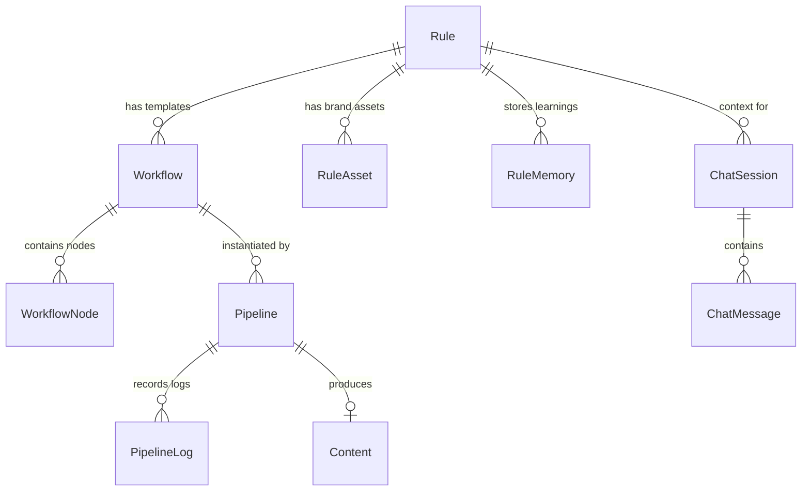

# 06. Database & API Reference

**Author:** LCN Alvin  
**Document Version:** 1.0  
**Last Updated:** 2026-11-05  
**Document Status:** Audit

## 1. Database Architecture & Prisma Entities

Mosonic utilizes PostgreSQL managed via Prisma ORM (`server/prisma/schema.prisma`). The primary models governing AI content generation are:



### Entity Specifications

#### `Content` Model
Stores final generation outputs, user edits, multi-channel lane snapshots, and approval states.
```prisma
model Content {
  contentId           String         @id @default(uuid())
  userId              String?
  pipelineRef         String
  workflowRef         String
  ruleRef             String
  outputs             Json           // Flattened ContentOutputs: { text?, image?, translatedText?, video? }
  userEdits           Json           // User overrides: ContentUserEdits
  nodePromptOverrides Json?
  nodeOutputs         Json           // Raw node outputs: { [nodeId]: { text?: string, ... } }
  nodeUserEdits       Json           // Node-level user edits
  laneOutputs         Json           // Lane-specific outputs: { [laneId]: { text?, adaptedCaption? } }
  currentVersion      Int?
  versions            Json?          // Version history snapshots
  status              ContentStatus  @default(draft)
  approval            Json           // ContentApprovalState
  createdAt           DateTime       @default(now())
  updatedAt           DateTime       @updatedAt
}
```

#### `Pipeline` Model
Tracks execution instances of a generation run.
```prisma
model Pipeline {
  pipelineId      String         @id @default(uuid())
  workflowId      String
  ruleId          String
  status          PipelineStatus @default(pending)
  contentPrompt   String         // User's original prompt string
  sourcePack      Json?          // PipelineSourcePack (notes, attachments)
  startedAt       DateTime       @default(now())
  completedAt     DateTime?
  logs            PipelineLog[]
}
```

#### `WorkflowNode` Model
Defines individual step configurations in a generation graph.
```prisma
model WorkflowNode {
  nodeId       String           @id @default(uuid())
  workflowId   String
  type         WorkflowNodeType // text_generation, adapt, image_generation, etc.
  lane         String?          // e.g., 'instagram', 'facebook'
  config       Json             // WorkflowNodeConfig (model, temperature, outputFormat, tone)
  order        Int?
}
```

---

## 2. API Reference

### 1. Send Chat Message
Submits a user prompt or template to the conversational agent.
- **Route**: `POST /api/v1/rule/chat/sessions/:sessionId/messages`
- **Controller**: `ChatSessionController.sendMessage` (`server/src/rule/chat/chat-session.controller.ts`)
- **Request Body**:
  ```json
  {
    "content": "🏎️ MAIN HEADLINE / CATCHY SLOGAN\nIntroducing the Brand Product...\n✨ Feature 1\n...",
    "assetIds": []
  }
  ```
- **Response**: Server-Sent Events (SSE) or JSON message object containing agent observations, tool calls (`start_generation`), and the resulting `pipeline_started` card.

### 2. Start Pipeline Execution (Direct API)
Direct execution trigger without chat agent intermediary.
- **Route**: `POST /api/v1/pipeline/start`
- **Controller**: `PipelineController.startPipeline` (`server/src/pipeline/pipeline.controller.ts`)
- **Request Body (`StartPipelineDto`)**:
  ```json
  {
    "workflowId": "wf-12345",
    "ruleId": "rule-67890",
    "contentPrompt": "Summer sale launch post",
    "metadata": { "source": "manual" }
  }
  ```
- **Response**:
  ```json
  {
    "pipelineId": "pipe-abcde",
    "status": "pending",
    "workflowId": "wf-12345"
  }
  ```

### 3. Get Content Draft Details
Retrieves complete content outputs for review.
- **Route**: `GET /api/v1/content/:contentId`
- **Controller**: `ContentController.getContent` (`server/src/content/content.controller.ts`)
- **Response**:
  ```json
  {
    "contentId": "cnt-998877",
    "pipelineRef": "pipe-abcde",
    "status": "draft",
    "outputs": {
      "text": "Experience the all-new Brand Product with cutting edge features...",
      "image": "https://storage.mosonic.com/uploads/pipeline-source/...jpg"
    },
    "laneOutputs": {
      "instagram": {
        "text": "Experience the all-new Brand Product with cutting edge features...",
        "adaptedCaption": "Experience the all-new Brand Product..."
      }
    }
  }
  ```

### 4. Update Content User Edits
Saves manual edits to generated text or sections.
- **Route**: `PATCH /api/v1/content/:contentId/user-edits`
- **Controller**: `ContentController.updateUserEdits` (`server/src/content/content.controller.ts`)
- **Request Body**:
  ```json
  {
    "text": "Updated headline and features manually written by user",
    "nodeUserEdits": {
      "node-text-1": { "text": "Updated text" }
    }
  }
  ```
- **Response**: Updated `Content` entity.