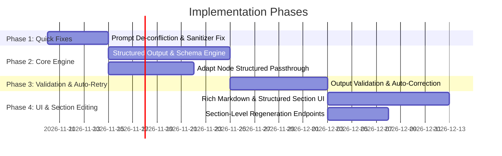

# 09. Implementation Roadmap & Migration Strategy

**Author:** LCN Alvin  
**Document Version:** 1.0  
**Last Updated:** 2026-11-05  
**Document Status:** Proposed

## 1. Prioritized Implementation Phases

To ensure stability, zero downtime, and backward compatibility with existing workflows, the architecture upgrade is structured into four distinct phases:

---

### Phase 1: Immediate Prompt De-confliction & Sanitizer Refinement (Quick Wins)
- **Goal**: Immediately stop the system from overwriting user-provided templates without schema migrations.
- **Tasks**:
  1. **Conditional Prompt Formatting (`text-generation.service.ts`)**:
     - Detect if `contentPrompt` contains structural markers (numbered lists, emojis, markdown headers, or multi-line breaks).
     - When detected, dynamically suppress the `Write in flowing paragraph form` constraint and replace it with:
       *"Follow the user's requested layout, sections, bullet points, and formatting structure precisely."*
  2. **Refine Guardrail Regex (`generated-text-guardrails.util.ts`)**:
     - Restrict art-direction stripping regex to specifically match only bracketed image/video directives (e.g. `[Visual: ...]`, `[Scene: ...]`), avoiding accidental deletion of user template brackets like `[Product intro]` or `[Call to action]`.
  3. **Adapt Node Instruction Adjustment (`adapt-node.service.ts`)**:
     - Update the adapt prompt: *"Preserve the structural layout, sections, and bullet points of the base copy; only tune vocabulary, tone, and character limits to suit the channel."*
- **Estimated Effort**: 3–5 developer days.
- **Risk**: Very Low. Fully backward-compatible.

---

### Phase 2: Structured Output Generation Engine (The Robust Core)
- **Goal**: Introduce deterministic, schema-guaranteed multi-section generation using OpenAI/Claude structured output APIs.
- **Tasks**:
  1. Add `getChatModelWithStructuredOutput<T>()` in `server/src/llm/llm.service.ts`.
  2. Define `StandardSectionSchema` in `server/src/nodes/schemas/workflow-node.schema.ts`.
  3. Update `ContentOutputs` interface to support an optional `sections?: Array<{ key: string, title: string, content: string }>` field alongside `text`.
  4. Implement an automatic markdown compiler that seamlessly stitches `sections` into `text` so existing downstream nodes and publishers continue working without changes.
- **Estimated Effort**: 7–10 developer days.
- **Risk**: Low. Dual-payload strategy guarantees legacy compatibility.

---

### Phase 3: Validation Engine & Automatic Correction Loop
- **Goal**: Guarantee output quality before content is stored or shown to the user.
- **Tasks**:
  1. Implement `OutputValidatorService` in `server/src/nodes/services/output-validation.service.ts`.
  2. Add section presence, non-empty content, and forbidden claim checks.
  3. Implement self-healing retry logic in `PipelineNodeProcessor` (maximum 1 automatic correction attempt on validation failure).
- **Estimated Effort**: 5–8 developer days.
- **Risk**: Low. Adds a safety barrier without altering existing execution paths.

---

### Phase 4: Frontend Structured Content Rendering & Section-Level Editing
- **Goal**: Elevate user experience with rich formatting and modular section controls.
- **Tasks**:
  1. Install `react-markdown` and remark plugins in `client/package.json`.
  2. Update `ContentDetailNodeCard.tsx`:
     - Render structured sections as discrete accordion/card items when `content.outputs.sections` is present.
     - Provide a live formatted Markdown preview tab alongside the editor.
  3. Implement section-level regeneration endpoint in `content.controller.ts` and connect it to a quick-refresh button next to each section in the UI.
- **Estimated Effort**: 8–10 developer days.
- **Risk**: Low. Frontend only adapts its rendering based on payload presence.

---

## 2. Migration & Backward Compatibility Strategy

To ensure zero regression for existing drafts, workflows, and published posts:
1. **Database Additions**:
   - Add nullable `sections Json?` column to the `Content` model in `schema.prisma`. Existing records remain valid with `null`.
2. **Dual-Writing in Engine**:
   - The generation engine will always populate `outputs.text` (the compiled markdown representation) AND `outputs.sections` (the structured array).
   - Any external integration (Social publishing, WhatsApp, Line, TikTok) that reads `outputs.text` will continue to function seamlessly.
3. **Frontend Graceful Fallback**:
   - If `content.outputs.sections` is missing (historical content), the frontend renders the existing raw `<Textarea>`.
   - If `content.outputs.sections` is present (new content), the frontend renders the new structured section layout.

---

## 3. Testing Strategy

1. **Unit Testing**:
   - Add prompt builder tests in `text-generation.service.spec.ts` verifying that templates with bullet points do NOT produce `"Write in flowing paragraph form"`.
   - Add guardrail tests in `generated-text-guardrails.util.spec.ts` ensuring bracketed placeholders like `[Call to Action]` are preserved.
2. **Integration Testing**:
   - End-to-end pipeline run tests verifying that inputting the 7-section Instagram template produces all 7 sections with 100% fidelity.
   - Channel adaptation tests verifying that Instagram and Facebook outputs retain section headers.
3. **Regression Testing**:
   - Run existing test suites across `pipeline.service.spec.ts`, `node-executor.video-routing.spec.ts`, and `chat-session.service.spec.ts`.