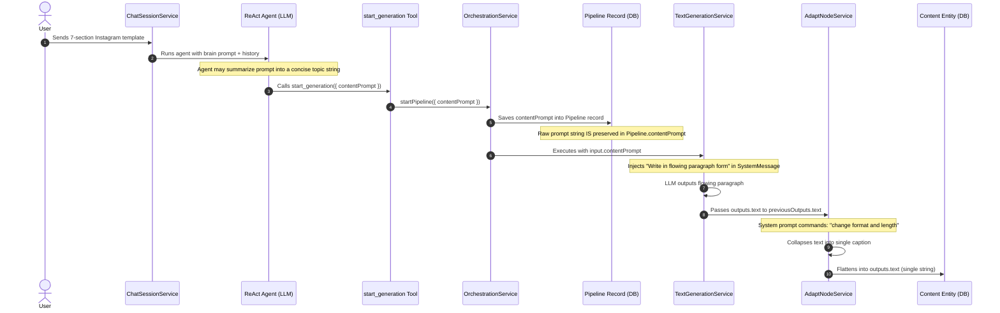
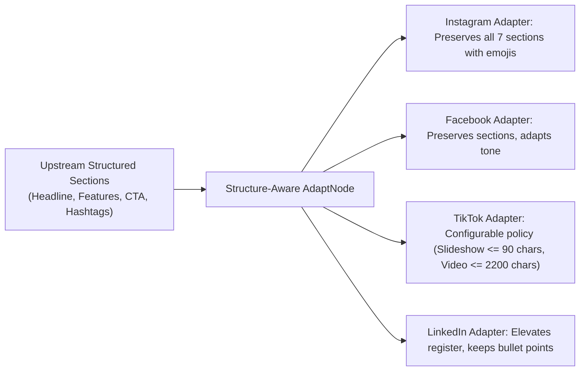

# 11. Follow-Up Audit & Architectural Decisions

**Author:** LCN Alvin  
**Document Version:** 1.1  
**Last Updated:** 2026-11-05  
**Document Status:** Verified Audit

## 1. Executive Summary

This document presents the findings of the **Second Technical Audit** for the Mosonic AI Content Generation Platform. Building upon the initial audit, this investigation rigorously verifies prior conclusions against actual execution behavior, performs empirical tests on sanitization filters, traces the exact lifecycle of user instructions, and presents an architectural design for structured, template-driven content generation.

---

## 2. Verification of Initial Audit Root Causes

Every finding from `07-root-cause-analysis.md` was re-tested and verified against the production codebase:

| Finding | Initial Classification | Re-Audit Status | Source Code Evidence & Empirical Findings |
| :--- | :--- | :--- | :--- |
| **System Prompt Constraint Inversion** | Confirmed | **CONFIRMED** | `server/src/nodes/services/text-generation.service.ts` (`buildSystemPrompt`, line 140). The system prompt unconditionally injects `Format: paragraph. Write in flowing paragraph form.` when `outputFormat` defaults to `Paragraph`. Modern frontier LLMs prioritize SystemMessage constraints over user instructions in HumanMessage, directly causing the structural collapse into narrative text. |
| **Downstream Adapt Node Overwrite** | Confirmed | **CONFIRMED** | `server/src/nodes/services/adapt-node.service.ts` (lines 75–95). Adapt node's system prompt explicitly instructs: `Preserve brand voice and factual content; change format and length for the platform.` It receives the base copy as a flat string, knows nothing about upstream sections, and collapses the text into a single-block caption. |
| **Regex Stripping of Bracketed Formatting** | Confirmed | **INCORRECT / OVERSTATED** | `server/src/nodes/services/generated-text-guardrails.util.ts`. Empirical testing of the actual regex demonstrates that `[Short product introduction]`, `[Key feature / benefit 1]`, and `[Call to Action – Shop Now!]` are **RETAINED** without change. The regex ONLY strips lines containing colons with meta keywords (e.g., `[Visual: ...]`, `[Image: ...]`, `[cta: click here]`). Thus, regex stripping is **NOT** the root cause of the paragraph collapse. |
| **Absence of Structured Output Contracts** | Confirmed | **CONFIRMED** | `server/src/llm/llm.service.ts` & `text-generation.service.ts`. Generation relies solely on plain-text completions (`llm.getChatModelForPlainText`). No JSON schema or Zod output enforcement exists. |
| **Monolithic Data Schema & Textarea UI** | Confirmed | **CONFIRMED** | `server/src/content/schemas/content.schema.ts` & `client/src/features/content/components/content-detail/content-detail-node-card.tsx`. Data model stores only flat `text?: string`. The frontend renders this directly inside an unstyled HTML `<Textarea>`. No markdown rendering or section components exist. |
| **Zero Output Validation** | Confirmed | **CONFIRMED** | No validation service exists in `server/src/` to verify section presence, count, or formatting against user instructions. |

---

## 3. Empirical Test: Guardrail Regex Sanitizer

To resolve ambiguity regarding `generated-text-guardrails.util.ts`, the actual regex logic was executed against specific test strings:

```typescript
// Test strings executed through sanitizeGeneratedPostText():
1. "[Short product introduction]"           --> RETAINED (No change)
2. "[Key feature / benefit 1]"             --> RETAINED (No change)
3. "[Call to Action – Shop Now!]"           --> RETAINED (No change)
4. "[Visual: Show product in stadium]"      --> STRIPPED (Matched art-direction regex)
5. "[Image: Product reference]"             --> STRIPPED (Matched art-direction regex)
6. "[action: click here]"                   --> STRIPPED (Matched single-line bracket instruction)
```

**Definitive Finding**: The regex guardrail correctly discriminates between art-direction directives and template headers lacking internal colons. The collapse into a paragraph occurs **during LLM inference** and **channel adaptation**, not during regex post-processing.

---

## 4. Lifecycle Trace: User Instruction Preservation

We traced how a user's multi-section prompt travels through the system:



### Trace Findings
1. **Chat Agent Parameter Extraction**: The ReAct agent in `ChatSessionService` is instructed by `start_generation.tool.ts`: *"What to generate this run, for example the post topic."* This description encourages the LLM to summarize rich templates into short topics.
2. **Pipeline Persistence**: In `orchestration.service.ts` line 347, `pipeline.contentPrompt` **does preserve** the string received from `start_generation`. The prompt is not lost in the database.
3. **Loss Across Node Boundaries**: Downstream nodes (`adapt-node.service.ts`) receive `input.contentPrompt` as a generic `Campaign brief`, but their system prompts instruct them to *"change format and length for the platform"*, effectively disregarding the structure of upstream copy.

---

## 5. Architectural Design: Flexible Content Generation

### 5.1 The Instruction Contract
Rather than passing an ambiguous freeform string, user requirements must be represented as an **Instruction Contract**:

```typescript
export interface InstructionContract {
  rawUserPrompt: string;              // Verbatim user message
  interpretedObjective: string;       // Extracted business topic
  templateRef?: string;              // Linked template ID if applicable
  enforceStructuredOutput: boolean;   // True if multi-section layout detected
  expectedSections?: Array<{
    key: string;
    title: string;
    required: boolean;
    format: 'text' | 'bullets' | 'cta' | 'hashtags';
    minItems?: number;
    maxItems?: number;
  }>;
  channelConstraints?: Record<string, { maxCharacters?: number }>;
}
```

### 5.2 Dynamic Template Model
Templates define reusable structural contracts:
- **System Built-in Templates**:
  - `instagram_promotional_7part`: Headline, Intro, Features (3-5 bullets), Promotion, Persuasive statement, CTA, Hashtags.
  - `linkedin_thought_leadership`: Hook, Context, Core Insight, Key Takeaways (bullets), Discussion Question.
  - `twitter_thread_structure`: Hook Tweet, Problem, Solution, Evidence, CTA.
- **Custom User Templates**: Ad-hoc templates parsed dynamically from user chat prompts.

### 5.3 Structured Content Representation
Generated content must be modeled as discrete, queryable sections:

```typescript
export interface ContentSection {
  key: string;              // e.g., 'headline', 'features', 'cta'
  title: string;            // e.g., 'Main Headline / Catchy Slogan'
  content: string;          // Section body text
  format: 'text' | 'bullets' | 'cta' | 'hashtags';
  items?: string[];         // Bullet items when format === 'bullets'
}

export interface StructuredContentOutput {
  templateId?: string;
  sections: ContentSection[];
  compiledText: string;     // Seamlessly assembled markdown for legacy publishers
}
```

---

## 6. Database Evaluation: Zero Migration Strategy

The first audit suggested potential database schema changes. However, inspecting `server/prisma/schema.prisma` reveals:

```prisma
model Content {
  contentId   String   @id @default(uuid())
  outputs     Json     // Prisma Json maps to JSONB in PostgreSQL
  nodeOutputs Json     // JSONB
  laneOutputs Json     // JSONB
  userEdits   Json     // JSONB
  ...
}

model Pipeline {
  pipelineId  String   @id @default(uuid())
  sourcePack  Json?    // JSONB
  ...
}
```

### Key Technical Finding
Because `outputs`, `laneOutputs`, `userEdits`, and `sourcePack` are already PostgreSQL **`JSONB`** columns:
- **No database schema migration is required.**
- `outputs` can immediately store `{ text: string, sections: ContentSection[] }`.
- `laneOutputs[laneId]` can store lane-specific section arrays.
- `sourcePack` can store the `InstructionContract`.
- Historical content records remain 100% valid with existing flat `text` properties.

---

## 7. Structure-Preserving Channel Adaptation

The Adapt Node (`adapt-node.service.ts`) must be redesigned from a "monolithic text rewriter" into a **section-aware transformer**:



---

## 8. Frontend Structured Content Architecture

The frontend must evolve from a raw `<Textarea>` into a dual-mode component:
1. **Structured Mode (New Content)**:
   - Renders individual section cards (`HeadlineCard`, `FeaturesList`, `CtaCard`).
   - Enables section-by-section editing.
   - Provides a per-section "Regenerate" button triggering section-level rewrites.
2. **Markdown Preview Tab**:
   - Renders live formatted markdown with bolding, lists, and emojis using `react-markdown`.
3. **Plain-Text Legacy Mode**:
   - Automatically fallbacks to standard `<Textarea>` if `outputs.sections` is not present on historical records.