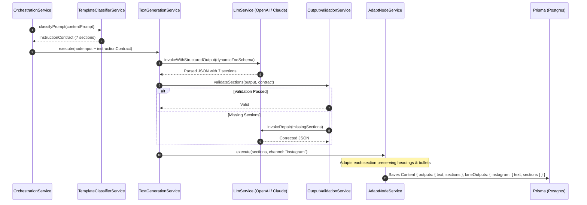

# 12. Technical Design Specification

**Author:** LCN Alvin  
**Document Version:** 1.1  
**Last Updated:** 2026-11-05  
**Document Status:** Proposed Specification

## 1. Overview & Purpose

This specification defines the engineering contracts, data schemas, API endpoints, component responsibilities, and validation mechanisms required to implement the **Structured Content Generation Architecture** across the Mosonic platform.

---

## 2. Core TypeScript Interfaces & Contracts

### 2.1 Instruction Contract
Located in `server/src/pipeline/contracts/instruction-contract.interface.ts`:

```typescript
export type SectionFormatType = 'text' | 'bullets' | 'cta' | 'hashtags';

export interface ExpectedSectionDefinition {
  key: string;                    // Machine key: 'headline', 'intro', 'features', 'cta'
  title: string;                  // Display title: 'Main Headline / Catchy Slogan'
  description?: string;           // Guidance for the LLM
  required: boolean;              // Validation mandatory flag
  format: SectionFormatType;      // Structural rendering type
  minItems?: number;              // Min items when format === 'bullets'
  maxItems?: number;              // Max items when format === 'bullets'
  placeholderRegex?: string;      // Optional regex to identify section in user prompt
}

export interface InstructionContract {
  contractId: string;
  rawUserPrompt: string;          // Verbatim input received from user
  interpretedTopic: string;       // Condensed topic for context/image prompts
  templateId?: string;           // Predefined template key (e.g. 'instagram_promo_7part')
  enforceStructuredOutput: boolean;
  sections: ExpectedSectionDefinition[];
  channelSpecificRules?: Record<string, {
    maxCharacters?: number;
    prohibitedElements?: string[];
  }>;
}
```

### 2.2 Structured Content Model
Located in `server/src/content/schemas/structured-content.schema.ts`:

```typescript
export interface ContentSectionData {
  key: string;
  title: string;
  content: string;
  format: SectionFormatType;
  items?: string[];               // Parsed bullet points
  characterCount: number;
}

export interface StructuredContentPayload {
  templateId?: string;
  sections: ContentSectionData[];
  compiledText: string;           // Markdown compiled representation
}

// Extends existing ContentOutputs without breaking legacy consumers
export interface ContentOutputsWithSections {
  text?: string;                  // Compiled markdown (Legacy & Social Publisher)
  sections?: ContentSectionData[]; // Structured sections for UI & granular editing
  image?: string;
  video?: string;
  translatedText?: string;
  summary?: string;
  keywords?: string;
}
```

---

## 3. Component Architecture & Responsibilities

```mermaid
graph TD
    subgraph IntakeModule ["server/src/pipeline/intake/"]
        Classifier["TemplateClassifierService<br/>Parses raw user prompt for section cues"]
        ContractBuilder["InstructionContractBuilder<br/>Constructs normalized InstructionContract"]
    end

    subgraph NodeExecutionModule ["server/src/nodes/services/"]
        TextGen["TextGenerationService<br/>Uses LangChain .withStructuredOutput(schema)"]
        AdaptGen["AdaptNodeService<br/>Structure-aware per-section channel adapter"]
        Validator["OutputValidationService<br/>Verifies presence and item bounds"]
    end

    subgraph ContentModule ["server/src/content/"]
        ContentUtil["content-node-output.util.ts<br/>Merges structured sections into Content entity"]
        Compiler["ContentMarkdownCompiler<br/>Compiles sections into clean markdown"]
    end

    Classifier --> ContractBuilder
    ContractBuilder --> TextGen
    TextGen --> Validator
    Validator -->|Pass| AdaptGen
    Validator -->|Fail (Retry < 2)| TextGen
    AdaptGen --> ContentUtil
    ContentUtil --> Compiler
```

### 3.1 Backend Service Responsibilities

1. **`TemplateClassifierService`** (`server/src/pipeline/intake/template-classifier.service.ts`):
   - Inspects `contentPrompt`. Detects if the prompt contains template patterns (e.g., numbered headers `1. Headline 2. Intro...` or markdown bullet patterns).
   - Generates an `InstructionContract` defining expected sections.
2. **`TextGenerationService`** (`server/src/nodes/services/text-generation.service.ts`):
   - Checks if `input.instructionContract?.enforceStructuredOutput` is true.
   - If true: Dynamically constructs a Zod schema from `InstructionContract.sections` and invokes the model with native structured outputs.
   - If false: Falls back gracefully to legacy plain-text generation.
3. **`OutputValidationService`** (`server/src/nodes/services/output-validation.service.ts`):
   - Validates that all `required` sections exist and are non-empty.
   - Verifies that bullet-point sections meet `minItems` and `maxItems`.
   - If validation fails, triggers a single-turn corrective generation repair prompt.
4. **`AdaptNodeService`** (`server/src/nodes/services/adapt-node.service.ts`):
   - If upstream output contains structured `sections`, it iterates over sections, preserving headings and bullet formatting while adjusting tone and vocabulary for the channel.
   - Enforces configurable channel limit policies (e.g. TikTok photo slideshow title <= 90 chars per `platform-limits.ts`, video caption <= 2200 chars) by strategically summarizing while preserving key tags.

---

## 4. API Endpoints Specification

### 4.1 Section-Level Content Regeneration
Allows targeted re-generation of a single section without re-running the entire pipeline.
- **Route**: `POST /api/v1/content/:contentId/sections/:sectionKey/regenerate`
- **Controller**: `ContentController.regenerateSection`
- **Request Body**:
  ```json
  {
    "instruction": "Make the call to action punchier with urgency"
  }
  ```
- **Response**:
  ```json
  {
    "sectionKey": "cta",
    "updatedContent": "🔥 Hurry, 40% off ends tonight – Shop Now!",
    "updatedCompiledText": "..."
  }
  ```

### 4.2 Update Specific Section Edit
- **Route**: `PATCH /api/v1/content/:contentId/sections/:sectionKey`
- **Request Body**:
  ```json
  {
    "content": "Manually edited headline"
  }
  ```
- **Response**: 200 OK with updated `Content` document.

---

## 5. Pipeline Execution Sequence



---

## 6. Backward Compatibility & Storage Strategy

- **Zero Schema Migrations**: Prisma model `Content` already stores `outputs Json`, `laneOutputs Json`, and `userEdits Json`. The structured payload is placed directly into `outputs.sections` and `laneOutputs[laneId].sections`.
- **Legacy Consumers**: All publishing modules (`server/src/social/`, `post.service.ts`) read `outputs.text`. `ContentMarkdownCompiler` automatically serializes `sections` into clean, human-readable markdown with double line breaks, emojis, and bullet points. Legacy publishers continue to work seamlessly.
- **Frontend Fallback**: The React client inspects `if (content.outputs?.sections?.length > 0)`. If present, it mounts `<StructuredSectionEditor />`. If absent (historical content), it mounts the existing `<Textarea />`.