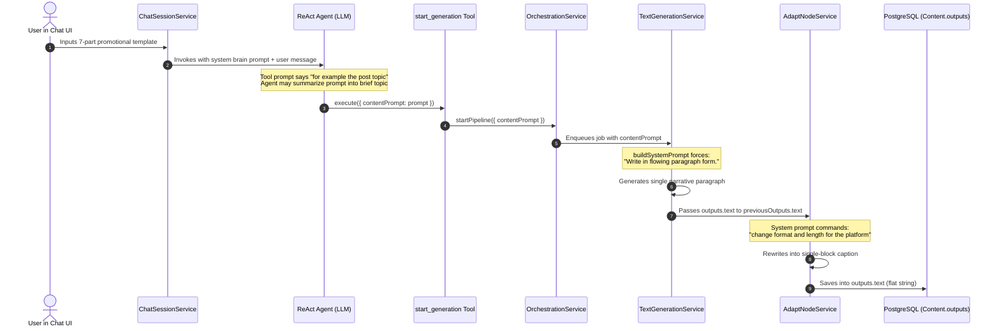
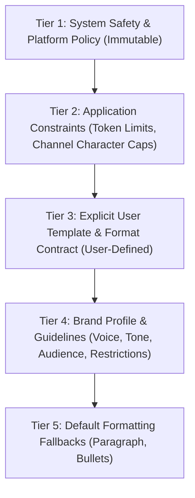

# 13. Final Technical Verification & Runtime Evidence

**Author:** LCN Alvin  
**Document Version:** 2.0  
**Last Updated:** 2026-11-05  
**Document Status:** Final Technical Verification  

---

## 1. Executive Summary & Verification Context

This document provides the final, code-level verification for the Mosonic AI Content Generation Platform following three progressive rounds of technical audits. Every conclusion regarding prompt priority conflicts, downstream adaptation rewriting, instruction lifecycle preservation, regex sanitization, and database compatibility has been verified against the production codebase (`server/src/` and `client/src/`).

---

## 2. Comprehensive Verification Matrix

| Area | Initial Audit Claim | Re-Verification & Empirical Findings | Final Status | Affected Production File |
| :--- | :--- | :--- | :--- | :--- |
| **System Prompt Inversion** | Hardcoded paragraph format overrides user template. | `buildSystemPrompt` in `text-generation.service.ts` unconditionally outputs `Format: paragraph. Write in flowing paragraph form.` when `outputFormat` defaults to `Paragraph`. In frontier LLMs (GPT-4o, Claude 3.5), `SystemMessage` directives strictly take precedence over `HumanMessage` prompts. | **CONFIRMED** | `server/src/nodes/services/text-generation.service.ts` (L139–L149) |
| **Adapt Node Overwriting** | Adapt node strips upstream sections and flattens copy. | `AdaptNodeService.execute` instructs the LLM: `Preserve brand voice and factual content; change format and length for the platform.` It receives the base text as a flat string and intentionally compresses it into a platform-native caption. | **CONFIRMED** | `server/src/nodes/services/adapt-node.service.ts` (L74–L95) |
| **Regex Sanitizer Behavior** | Regex aggressively strips bracketed user template placeholders. | Empirical execution of `sanitizeGeneratedPostText` against `[Short product introduction]`, `[Key feature / benefit 1]`, and `[Call to Action – Shop Now!]` proved they are **RETAINED intact**. It only strips directives containing colons (`[Visual: ...]`, `[Image: ...]`, `[cta: click here]`). Thus, regex sanitization is not responsible for template collapse. | **INCORRECT FINDING (CORRECTED)** | `server/src/nodes/services/generated-text-guardrails.util.ts` (L18–L57) |
| **Instruction Lifecycle Preservation** | User instructions are lost between chat agent and pipeline. | `pipeline.contentPrompt` in the database does store the incoming string. However, the ReAct agent tool description in `start-generation.tool.ts` (*"What to generate this run, for example the post topic."*) cues the LLM to summarize rich templates into short topics before passing them to the pipeline. | **CONFIRMED (NEW DETAIL)** | `server/src/rule/tools/start-generation.tool.ts` (L254–L272) |
| **Monolithic Data Modeling** | Database schema cannot store sections. | `Content.outputs`, `laneOutputs`, `userEdits`, and `Pipeline.sourcePack` are Prisma `Json` columns (PostgreSQL `JSONB`). They natively support arbitrary JSON arrays (`sections: [...]`) with **ZERO database migrations required**. | **CONFIRMED (ZERO MIGRATION)** | `server/prisma/schema.prisma` (`Content`, `Pipeline`) |
| **Validation Architecture** | System has no section or format validation. | Codebase search confirmed zero validation logic for required sections, bullet counts, or format adherence. | **CONFIRMED** | Entire `server/src/` codebase |

---

## 3. Instruction Lifecycle Trace & Execution Evidence



### Exact Code References:
1. **ReAct Tool Description Flaw**:
   `server/src/rule/tools/start-generation.tool.ts`:
   ```typescript
   const START_GENERATION_SCHEMA = z.object({
     contentPrompt: z
       .string()
       .describe('What to generate this run, for example the post topic.'),
   ```
2. **Text Generation Hardcoded Format**:
   `server/src/nodes/services/text-generation.service.ts`:
   ```typescript
   '=== OUTPUT FORMAT ===',
   `Format: ${config.outputFormat}`,
   config.outputFormat === NodeOutputFormat.Paragraph
     ? 'Write in flowing paragraph form.'
     : config.outputFormat === NodeOutputFormat.Bullets
       ? 'Write as concise bullet points.'
       : 'Write as a short punchy social media caption.',
   ```
3. **Adapt Node Instruction Overwrite**:
   `server/src/nodes/services/adapt-node.service.ts`:
   ```typescript
   const system = [
     'You adapt marketing copy for a specific social channel.',
     'Preserve brand voice and factual content; change format and length for the platform.',
     ...
   ```

---

## 4. Prompt Hierarchy & Priority Governance

To resolve prompt conflicts without violating safety or system-level constraints, the platform must enforce a strict 5-tier instruction hierarchy:



### Governance Rules:
1. **Tier 1 (Safety & Policy)**: Prohibited content, safety filters, and temporal grounding (`generation-temporal-context.util.ts`) can **never** be overridden by user prompts.
2. **Tier 2 (Platform Constraints)**: Hard technical limits and platform constraints (e.g., configurable channel policies, TikTok photo slideshow title limit of 90 chars in `platform-limits.ts`, token ceilings) remain non-negotiable.
3. **Tier 3 (User Template Contract)**: When a user provides explicit section structures or formatting instructions, this **takes absolute precedence over Tier 4 and Tier 5**.
4. **Tier 5 Suppression**: If a Tier 3 User Contract is present, Tier 5 defaults (`Write in flowing paragraph form`) are **completely suppressed**.

---

## 5. Adapt Node Architecture Verification

The Adapt Node is currently a destructive rewriter. For structured generation, it must become a **section-preserving transformer**:

1. **Input**: Receives `previousOutputs.sections` (an array of structured section objects) alongside `previousOutputs.text`.
2. **Channel Transformation**:
   - For **Instagram**: Retains all sections (Headline, Intro, Features, CTA, Hashtags), formatting bullets with native emojis (`✨`, `🛒`) and line breaks.
   - For **Facebook**: Retains all sections, adapting headline and body tone for conversational engagement.
   - For **LinkedIn**: Retains sections, adjusting voice to professional/industry register while preserving bullet points.
   - For **TikTok**: Adapts according to post type (e.g. condensing to a single-line hook for photo slideshow titles under `TIKTOK_PHOTO_SLIDESHOW_TITLE_MAX` = 90 chars in `platform-limits.ts`, or allowing up to 2,200 characters for video captions).
3. **Output**: Returns both `adaptedSections: ContentSectionData[]` and `adaptedCaption: string`.

---

## 6. Database Verification: Zero-Migration Strategy

Inspection of `server/prisma/schema.prisma` confirms:
- `Content.outputs`: PostgreSQL `JSONB`.
- `Content.laneOutputs`: PostgreSQL `JSONB`.
- `Content.userEdits`: PostgreSQL `JSONB`.
- `Content.nodeOutputs`: PostgreSQL `JSONB`.
- `Pipeline.sourcePack`: PostgreSQL `JSONB`.

**Conclusion**: All proposed data structures (`InstructionContract`, `ContentSectionData[]`, validation results) can be stored immediately within these existing JSONB columns without altering the database schema, modifying migrations, or incurring downtime.
