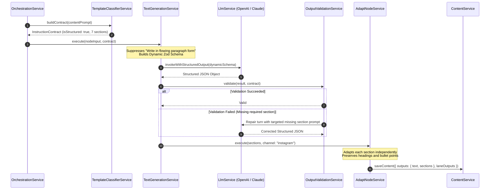

# 14. Final Implementation Blueprint & Engineering Contracts

**Author:** LCN Alvin  
**Document Version:** 2.0  
**Last Updated:** 2026-11-05  
**Document Status:** Final Implementation Blueprint  

---

## 1. Architectural Blueprint Overview

The **Structured Content Generation Engine** enables Mosonic to natively process, generate, adapt, validate, and display complex multi-section content templates (e.g., 7-part promotional posts, thought-leadership structures, product comparisons) while preserving 100% backward compatibility with legacy workflows.

```mermaid
graph TD
    UserChat["User Chat / REST API Request"] --> Classifier["TemplateClassifierService"]
    
    subgraph IntakeAndContracts ["1. Intake & Contract Formulation"]
        Classifier --> ContractBuilder["InstructionContractBuilder"]
        ContractBuilder --> Contract["InstructionContract (Stored in sourcePack)"]
    end
    
    subgraph GenerationPipeline ["2. Pipeline Node Execution"]
        Contract --> TextGen["TextGenerationService<br/>(Dynamic Zod Schema with .withStructuredOutput)"]
        TextGen --> Validator["OutputValidationService"]
        Validator -->|Pass| AdaptNode["AdaptNodeService<br/>(Per-Section Channel Adaptation)"]
        Validator -->|Fail (Max 1 retry)| RepairLLM["Correction Repair Turn"]
        RepairLLM --> Validator
    end
    
    subgraph PersistenceLayer ["3. Dual-Format Persistence"]
        AdaptNode --> NodeFlatten["content-node-output.util.ts"]
        NodeFlatten --> DB[("PostgreSQL Content Record")]
        DB --> FlatMarkdown["outputs.text (Compiled Markdown for Social Publishing)"]
        DB --> StructuredSections["outputs.sections (JSONB for Structured UI Editor)"]
    end
    
    subgraph PresentationLayer ["4. Dual-Mode Frontend"]
        StructuredSections --> SectionUI["StructuredSectionEditor (React)"]
        FlatMarkdown --> MarkdownTab["Live Rich Markdown Preview"]
    end
```

---

## 2. Definitive TypeScript Interfaces & Schemas

### 2.1 Instruction Contract Schema
Located in `server/src/pipeline/contracts/instruction-contract.interface.ts`:

```typescript
export type SectionKind =
  | 'heading'
  | 'paragraph'
  | 'bullet_list'
  | 'numbered_list'
  | 'call_to_action'
  | 'hashtags'
  | 'quote'
  | 'rich_text'
  | 'link'
  | 'image_direction'
  | 'video_scene'
  | 'script'
  | 'custom_block';

/** Type-safe discriminated union supporting diverse social channels, scripts, and video prompts. */
export type SectionPayload =
  | { kind: 'heading'; text: string; level: 1 | 2 | 3 | 4 | 5 | 6 }
  | { kind: 'paragraph'; text: string }
  | { kind: 'bullet_list'; items: string[] }
  | { kind: 'numbered_list'; items: string[] }
  | { kind: 'call_to_action'; text: string; url?: string; actionType?: string }
  | { kind: 'hashtags'; tags: string[] }
  | { kind: 'quote'; quote: string; attribution?: string }
  | { kind: 'link'; title: string; url: string; previewText?: string }
  | { kind: 'image_direction'; visualDescription: string; aspectPrompt?: string }
  | { kind: 'video_scene'; sceneNumber: number; visual: string; narration?: string; durationSeconds?: number }
  | { kind: 'script'; speaker: string; dialogue: string; cues?: string }
  | { kind: 'rich_text'; markdown: string }
  | { kind: 'custom_block'; blockType: string; data: Record<string, unknown> };

export interface SectionContractDefinition {
  key: string;                    // e.g. 'headline', 'intro', 'features', 'cta'
  title: string;                  // Display title in UI
  kind: SectionKind;
  required: boolean;
  minItems?: number;              // Applicable for bullet_list
  maxItems?: number;              // Applicable for bullet_list
  guidelines?: string;            // LLM prompt guidance for this section
}

export interface InstructionContract {
  contractId: string;
  rawUserPrompt: string;          // Verbatim user input
  interpretedTopic: string;       // Condensed topic for context/image prompts
  templateId?: string;           // Predefined template key
  isStructured: boolean;          // True when multi-section template is active
  sections: SectionContractDefinition[];
  channelRules?: Record<string, {
    maxCharacters?: number;
    preferredKind?: SectionKind;
  }>;
}
```

### 2.2 Structured Content Output Model
Located in `server/src/content/schemas/structured-content.schema.ts`:

```typescript
export interface ContentSectionItem {
  key: string;
  title: string;
  kind: SectionKind;
  content: string;                // Raw section text
  items?: string[];               // Extracted bullets if kind === 'bullet_list'
  charCount: number;
}

export interface ContentOutputsExtended {
  text?: string;                  // Compiled clean markdown (for social posting)
  sections?: ContentSectionItem[]; // Modular section array (for UI & granular edits)
  image?: string;
  video?: string;
  translatedText?: string;
  summary?: string;
  keywords?: string;
}
```

---

## 3. Dynamic Zod Generation in `TextGenerationService`

When `InstructionContract.isStructured` is `true`, `TextGenerationService` dynamically generates a Zod schema passed to LangChain's `.withStructuredOutput()`:

```typescript
export function buildDynamicSectionZodSchema(
  sections: SectionContractDefinition[],
): z.ZodObject<Record<string, z.ZodTypeAny>> {
  const shape: Record<string, z.ZodTypeAny> = {};

  for (const s of sections) {
    if (s.kind === 'bullet_list') {
      let arraySchema = z.array(z.string()).describe(s.guidelines || s.title);
      if (s.minItems) arraySchema = arraySchema.min(s.minItems);
      if (s.maxItems) arraySchema = arraySchema.max(s.maxItems);
      shape[s.key] = s.required ? arraySchema : arraySchema.optional();
    } else {
      let stringSchema = z.string().describe(s.guidelines || s.title);
      shape[s.key] = s.required ? stringSchema : stringSchema.optional();
    }
  }

  return z.object(shape);
}
```

---

## 4. Pipeline Execution Sequence



---

## 5. API Endpoints Specification

### 5.1 Section-Level Content Regeneration
Allows targeted re-generation of a single section without re-running the entire pipeline.
- **Route**: `POST /api/v1/content/:contentId/sections/:sectionKey/regenerate`
- **Controller**: `ContentController.regenerateSection`
- **Request Body**:
  ```json
  {
    "instruction": "Make the call to action punchier with urgency"
  }
  ```
- **Response Body**:
  ```json
  {
    "sectionKey": "cta",
    "updatedContent": "🔥 Hurry, 40% off ends tonight – Shop Now!",
    "updatedCompiledText": "..."
  }
  ```

### 5.2 Patch Specific Section
- **Route**: `PATCH /api/v1/content/:contentId/sections/:sectionKey`
- **Request Body**:
  ```json
  {
    "content": "Updated headline text"
  }
  ```
- **Response**: Updated `Content` entity.

---

## 6. Backward Compatibility & Storage Strategy

1. **Storage Compatibility**: In PostgreSQL, `Content.outputs`, `Content.laneOutputs`, and `Pipeline.sourcePack` are `JSONB`. Storing `sections` alongside `text` requires no database migrations.
2. **Social Media Publishing Compatibility**: All external publishing connectors (`server/src/social/`, `post.service.ts`) read `outputs.text`. A dedicated `ContentMarkdownCompiler` utility compiles `sections` into markdown with double line breaks, emojis, and bullet points. Legacy publishers continue to work with zero modifications.
3. **Frontend Compatibility**: The React client checks `if (content.outputs?.sections?.length > 0)`. If true, it renders the new structured section editor; if false, it renders the standard `<Textarea />`.
