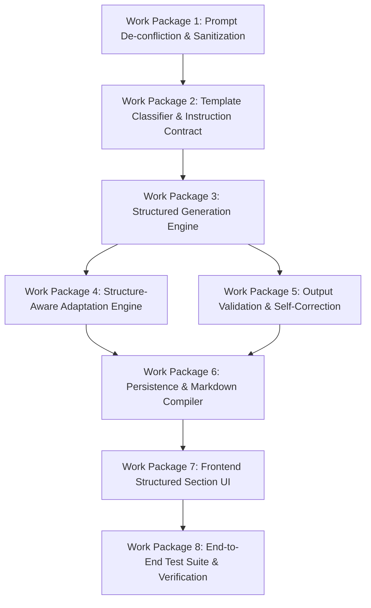

# 15. Implementation Task Breakdown & Engineering Work Packages

**Author:** LCN Alvin  
**Document Version:** 2.0  
**Last Updated:** 2026-11-05  
**Document Status:** Actionable Implementation Breakdown  

---

## 1. Overview & Work Package Structure

This document breaks down the implementation into actionable engineering tasks across the full stack. Every task defines clear dependencies, affected files, acceptance criteria, and complexity ratings.

---

## 2. Work Package Details & Task Catalog

### Work Package 1: Prompt De-confliction & Sanitizer Tuning (Immediate Quick Win)

#### Task 1.1: Conditional System Prompt Formatting
- **Task ID**: `TASK-PROMPT-01`
- **Priority**: P0 (Blocker)
- **Complexity**: Low (1–2 days)
- **Objective**: Dynamically suppress the `"Write in flowing paragraph form"` directive in `TextGenerationService` when a user prompt provides structural layout instructions.
- **Affected Existing Files**: `server/src/nodes/services/text-generation.service.ts`
- **Proposed New Files**: None
- **Dependencies**: None
- **Acceptance Criteria**:
  - When `contentPrompt` contains bullet points, emojis, numbered items, or markdown headers, the system prompt replaces `Write in flowing paragraph form` with `Strictly adhere to the user's requested layout, sections, bullet points, and formatting structure.`
  - When no formatting cues exist, legacy behavior is preserved.
- **Testing Requirements**: Unit test in `text-generation.service.spec.ts` asserting prompt output strings for both plain and structured inputs.

#### Task 1.2: Chat ReAct Tool Prompt Preservation
- **Task ID**: `TASK-PROMPT-02`
- **Priority**: P0 (Blocker)
- **Complexity**: Low (1 day)
- **Objective**: Update the tool description in `start-generation.tool.ts` so the ReAct agent model passes verbatim user prompt templates rather than summarizing them into brief topics.
- **Affected Existing Files**: `server/src/rule/tools/start-generation.tool.ts`
- **Proposed New Files**: None
- **Dependencies**: None
- **Acceptance Criteria**:
  - In `START_GENERATION_SCHEMA`, update `contentPrompt` description to explicitly instruct: *"Pass the complete verbatim user prompt and any requested formatting template. Do NOT summarize or condense."*
- **Testing Requirements**: Chat ReAct agent simulation test verifying that full 7-section templates are forwarded into `startPipeline`.

---

### Work Package 2: Template Engine & Instruction Contract

#### Task 2.1: Instruction Contract Interface Definition
- **Task ID**: `TASK-CONTRACT-01`
- **Priority**: P0
- **Complexity**: Low (1 day)
- **Objective**: Define core TypeScript interfaces for `InstructionContract`, `SectionContractDefinition`, and `ContentSectionData`.
- **Affected Existing Files**: None
- **Proposed New Files**: `server/src/pipeline/contracts/instruction-contract.interface.ts`
- **Dependencies**: None
- **Acceptance Criteria**: Exports full types with validation schemas.

#### Task 2.2: Template Classifier & Contract Builder
- **Task ID**: `TASK-CONTRACT-02`
- **Priority**: P1
- **Complexity**: Medium (3 days)
- **Objective**: Implement service that detects template patterns in user prompts or resolves predefined templates.
- **Affected Existing Files**: `server/src/orchestration/orchestration.service.ts`
- **Proposed New Files**: `server/src/pipeline/intake/template-classifier.service.ts`
- **Dependencies**: `TASK-CONTRACT-01`
- **Acceptance Criteria**: Accurately classifies the 7-part Instagram template into 7 discrete `ExpectedSectionDefinition` objects.

---

### Work Package 3: Structured Generation Engine

#### Task 3.1: LLM Service Structured Output Binding
- **Task ID**: `TASK-GEN-01`
- **Priority**: P0
- **Complexity**: Medium (2 days)
- **Objective**: Add `getChatModelWithStructuredOutput<T>(schema: z.ZodSchema<T>)` to `LlmService` using LangChain `.withStructuredOutput()` and OpenAI `json_schema`.
- **Affected Existing Files**: `server/src/llm/llm.service.ts`
- **Proposed New Files**: None
- **Dependencies**: None
- **Acceptance Criteria**: Successfully invokes GPT-4o, Claude 3.5 Sonnet, and Gemini 1.5 Pro returning typed JSON objects.

#### Task 3.2: Dynamic Schema Generation in `TextGenerationService`
- **Task ID**: `TASK-GEN-02`
- **Priority**: P0
- **Complexity**: Medium (3 days)
- **Objective**: Integrate dynamic Zod schema building in `TextGenerationService` when `InstructionContract.isStructured === true`.
- **Affected Existing Files**: `server/src/nodes/services/text-generation.service.ts`
- **Proposed New Files**: `server/src/nodes/services/dynamic-zod-schema.builder.ts`
- **Dependencies**: `TASK-GEN-01`, `TASK-CONTRACT-02`
- **Acceptance Criteria**: Generation returns structured JSON containing all requested sections.

---

### Work Package 4: Structure-Aware Adaptation Engine

#### Task 4.1: Adapt Node Section-by-Section Transformer
- **Task ID**: `TASK-ADAPT-01`
- **Priority**: P1
- **Complexity**: Medium (3 days)
- **Objective**: Upgrade `AdaptNodeService` to accept `previousOutputs.sections`, adapting each section independently while preserving headings and bullet lists.
- **Affected Existing Files**: `server/src/nodes/services/adapt-node.service.ts`
- **Proposed New Files**: None
- **Dependencies**: `TASK-GEN-02`
- **Acceptance Criteria**: Instagram adaptation retains all 7 sections with emojis; TikTok adaptation applies configurable channel policies (e.g. photo slideshow title <= 90 chars per `platform-limits.ts`, or video caption <= 2200 chars).

---

### Work Package 5: Output Validation & Self-Correction Loop

#### Task 5.1: Output Validation Engine
- **Task ID**: `TASK-VAL-01`
- **Priority**: P1
- **Complexity**: Medium (2 days)
- **Objective**: Validate generated sections against `InstructionContract` (presence, non-empty text, bullet count bounds).
- **Affected Existing Files**: None
- **Proposed New Files**: `server/src/nodes/services/output-validation.service.ts`
- **Dependencies**: `TASK-CONTRACT-01`
- **Acceptance Criteria**: Flags missing sections or count violations with deterministic error payloads.

#### Task 5.2: Automated Single-Turn Correction Retry
- **Task ID**: `TASK-VAL-02`
- **Priority**: P1
- **Complexity**: Medium (3 days)
- **Objective**: If `OutputValidationService` reports failure, trigger a targeted repair LLM call (max 1 retry) before job failure.
- **Affected Existing Files**: `server/src/nodes/services/text-generation.service.ts`
- **Proposed New Files**: None
- **Dependencies**: `TASK-VAL-01`
- **Acceptance Criteria**: Corrects missing sections in 90%+ of synthetic partial generation tests.

---

### Work Package 6: Persistence & Markdown Compiler

#### Task 6.1: Dual-Write Serialization & Markdown Compiler
- **Task ID**: `TASK-PERSIST-01`
- **Priority**: P0
- **Complexity**: Low (2 days)
- **Objective**: Build utility that stitches `sections` into clean markdown (`outputs.text`) and saves both `sections` and `text` into `Content.outputs`.
- **Affected Existing Files**: `server/src/content/content-node-output.util.ts`, `server/src/content/content.service.ts`
- **Proposed New Files**: `server/src/content/content-markdown-compiler.util.ts`
- **Dependencies**: `TASK-GEN-02`
- **Acceptance Criteria**: Downstream social publishers reading `outputs.text` publish fully formatted copy without regressions.

---

### Work Package 7: Frontend Structured Section UI

#### Task 7.1: Structured Section Card Editor
- **Task ID**: `TASK-UI-01`
- **Priority**: P1
- **Complexity**: High (4 days)
- **Objective**: Replace raw `<Textarea>` in `ContentDetailNodeCard.tsx` with modular section components (`HeadlineField`, `BulletListEditor`, `CtaField`).
- **Affected Existing Files**: `client/src/features/content/components/content-detail/content-detail-node-card.tsx`
- **Proposed New Files**: `client/src/features/content/components/content-detail/structured-section-editor.tsx`
- **Dependencies**: `TASK-PERSIST-01`
- **Acceptance Criteria**: Displays discrete editable section cards when `outputs.sections` is present; falls back to raw `<Textarea>` when absent.

#### Task 7.2: Live Rich Markdown Preview Tab
- **Task ID**: `TASK-UI-02`
- **Priority**: P2
- **Complexity**: Low (2 days)
- **Objective**: Add formatted Markdown preview tab using `react-markdown` with syntax styling for emojis and headers.
- **Affected Existing Files**: `client/src/features/content/components/content-detail/content-detail-node-card.tsx`
- **Proposed New Files**: `client/src/features/content/components/content-detail/content-markdown-preview.tsx`
- **Dependencies**: `TASK-UI-01`
- **Acceptance Criteria**: Renders formatted bold text, bullet points, and emojis with 1-click copy button.

#### Task 7.3: Section-Level Quick Regeneration API & UI
- **Task ID**: `TASK-UI-03`
- **Priority**: P2
- **Complexity**: Medium (3 days)
- **Objective**: Add `POST /api/v1/content/:id/sections/:key/regenerate` endpoint and wire it to a refresh icon button next to each section card.
- **Affected Existing Files**: `server/src/content/content.controller.ts`, `server/src/content/content.service.ts`
- **Proposed New Files**: None
- **Dependencies**: `TASK-UI-01`
- **Acceptance Criteria**: User can regenerate only the Headline or CTA without altering the rest of the post.

---

### Work Package 8: End-to-End Verification & Integration Test Suite

#### Task 8.1: Full Pipeline Integration Tests
- **Task ID**: `TASK-TEST-01`
- **Priority**: P0
- **Complexity**: Medium (3 days)
- **Objective**: Add comprehensive end-to-end test cases covering the 7-section Instagram template, LinkedIn thought-leadership, and TikTok short caption.
- **Affected Existing Files**: None
- **Proposed New Files**: `server/test/structured-content-pipeline.e2e-spec.ts`
- **Dependencies**: All prior tasks
- **Acceptance Criteria**: 100% pass rate on template fidelity tests.
