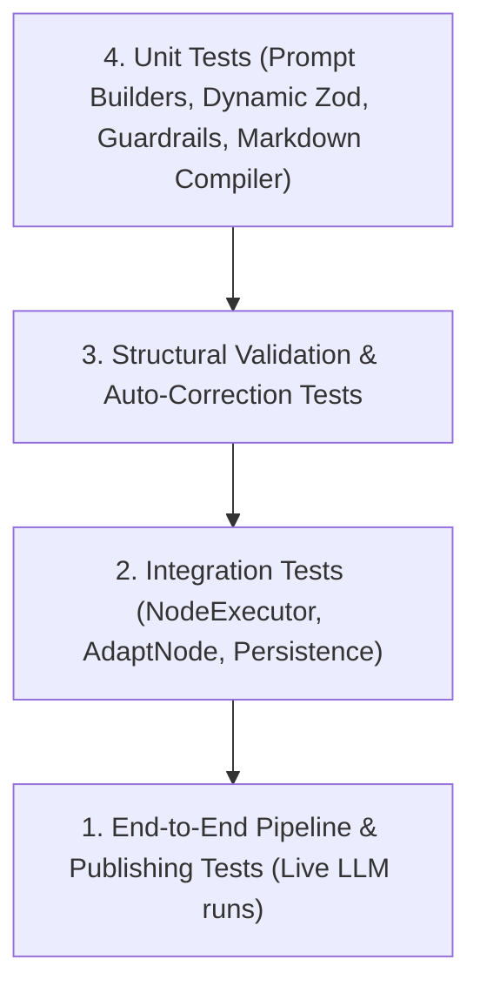

# 16. Test Strategy & Acceptance Criteria

**Author:** LCN Alvin  
**Document Version:** 2.0  
**Last Updated:** 2026-11-05  
**Document Status:** Quality Assurance & Testing Strategy  

---

## 1. Testing Philosophy & Test Pyramid

To guarantee that structured content generation adheres strictly to user-specified templates without introducing regressions to existing workflows, we employ a multi-layered verification pyramid:



---

## 2. Test Suites Specification

### 2.1 Unit Tests

#### A. Prompt De-confliction Tests (`text-generation.service.spec.ts`)
- **Test Case `UT-PROMPT-01`**: Given a `contentPrompt` containing numbered section labels (e.g., `1. Main Headline`), assert that `buildSystemPrompt()` does NOT contain `"Write in flowing paragraph form"`.
- **Test Case `UT-PROMPT-02`**: Given an unformatted plain-text prompt (`"summer shoe launch"`), assert that `buildSystemPrompt()` retains standard fallback directives.
- **Test Case `UT-PROMPT-03`**: Given a prompt with bullet items, assert that the system prompt includes `"Strictly follow the user's requested layout and bullet structure"`.

#### B. Dynamic Schema Builder Tests (`dynamic-zod-schema.builder.spec.ts`)
- **Test Case `UT-ZOD-01`**: Given an `InstructionContract` with 7 sections (including a `bullet_list` with `minItems: 4`), verify that the resulting Zod schema validates valid payloads and rejects payloads missing mandatory keys.
- **Test Case `UT-ZOD-02`**: Verify that optional sections (e.g., `promotion`) produce `.optional()` fields in the generated Zod schema.

#### C. Guardrail Regex Tests (`generated-text-guardrails.util.spec.ts`)
- **Test Case `UT-GUARD-01`**: Verify that `[Visual: ...]` and `[Image: ...]` are stripped.
- **Test Case `UT-GUARD-02`**: Verify that `[Short product introduction]`, `[Key feature / benefit 1]`, and `[Call to Action – Shop Now!]` are **RETAINED** without alteration.

#### D. Markdown Compiler Tests (`content-markdown-compiler.spec.ts`)
- **Test Case `UT-COMPILER-01`**: Compile 7 sections into a single markdown string. Assert that headers, double newlines, bullet characters, and emojis match expected publishing format.

---

### 2.2 Integration Tests

#### A. Adapt Node Structure Preservation (`adapt-node.service.spec.ts`)
- **Test Case `IT-ADAPT-01 (Instagram)`**: Input 7 sections. Execute `adapt` for `channel: "instagram"`. Assert that output contains all 7 sections with emojis intact.
- **Test Case `IT-ADAPT-02 (TikTok)`**: Input 7 sections. Execute `adapt` for `channel: "tiktok"` (photo slideshow mode). Assert that title output is condensed to $\le 90$ characters per `TIKTOK_PHOTO_SLIDESHOW_TITLE_MAX` in `platform-limits.ts`, while preserving core hook and CTA.
- **Test Case `IT-ADAPT-03 (LinkedIn)`**: Input 7 sections. Execute `adapt` for `channel: "linkedin"`. Assert that professional register is applied and bullet points remain intact.

#### B. Validation Engine & Self-Correction (`output-validation.service.spec.ts`)
- **Test Case `IT-VAL-01`**: Pass a mock LLM output missing the `"callToAction"` section. Assert that `OutputValidationService` returns `valid: false` with error message `"Missing required section: callToAction"`.
- **Test Case `IT-VAL-02`**: Execute the self-healing retry turn. Assert that the repair prompt successfully recovers the missing section.

---

### 2.3 Realistic End-to-End Acceptance Scenarios

#### Scenario 1: The 7-Part Instagram Promotional Launch
- **Input Prompt**:
  ```markdown
  **🏎️ MAIN HEADLINE / CATCHY SLOGAN**
  Introducing the [BRAND] [PRODUCT NAME / MODEL].
  [Short product introduction or lifestyle statement]
  ✨ [Key feature / benefit 1]
  ✨ [Key feature / benefit 2]
  ✨ [Key feature / benefit 3]
  ✨ [Key feature / benefit 4]
  **📢 [PROMOTION / CAMPAIGN NAME]**
  [Main promotional offer / discount]
  [Short persuasive sentence encouraging customers to purchase]
  **🛒 [Call to Action – Shop Now!]**
  #Brand #ProductName #CampaignName #Promotion #RelevantHashtags
  ```
- **Acceptance Criteria**:
  1. `outputs.sections` contains exactly 7 items corresponding to the requested sections.
  2. The `features` section contains at least 4 bullet points.
  3. The `cta` section contains action-oriented purchase text.
  4. The `hashtags` section contains at least 5 relevant hashtags.
  5. The output is **NOT** flattened into a single paragraph.

#### Scenario 2: LinkedIn Thought Leadership Article
- **Input Prompt**:
  ```markdown
  # Hook: The surprising trend in AI automation
  ## Context & Problem
  ## Key Insights (3 bullet points)
  ## Strategic Recommendation
  ## Discussion Question
  ```
- **Acceptance Criteria**:
  1. `outputs.sections` contains 5 distinct sections.
  2. LinkedIn adapt node preserves business tone and bullet formatting.

#### Scenario 3: Legacy Backward Compatibility Run
- **Input Prompt**: `"Write a casual announcement post for our new cafe opening"` (No template specified).
- **Acceptance Criteria**:
  1. System falls back to standard copy generation.
  2. `outputs.text` is populated.
  3. Legacy UI renders `<Textarea>` without crashing or showing blank fields.

---

## 3. Regression & Quality Gate Criteria

| Criterion | Threshold | Verification Method |
| :--- | :--- | :--- |
| **Unit Test Coverage** | $\ge 90\%$ on new files | Automated Jest test runner |
| **Template Adherence Rate** | $100\%$ on standard benchmark templates | 20 consecutive live test runs |
| **Section Presence Rate** | $\ge 98\%$ on first attempt, $100\%$ post-repair | Automated validation telemetry |
| **Backward Compatibility** | $100\%$ pass on historical draft rendering | Visual and snapshot regression tests |
| **API Latency Overhead** | $\le 200	ext{ms}$ additional overhead | Performance benchmarking |
