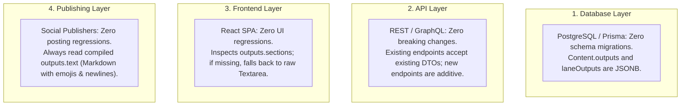

# 18. Final Review, Technical Clarifications & Outstanding Decisions

**Author:** LCN Alvin  
**Document Version:** 1.0  
**Last Updated:** 2026-11-05  
**Document Status:** Final Quality Review  

---

## 1. Executive Summary & Purpose

This document performs the final documentation quality review and technical harmonization for the Mosonic AI Content Generation Platform audit suite. It explicitly reconciles historical audit findings, corrects technical assumptions regarding prompt priority and provider compatibility, formalizes concurrency controls and authorization requirements for section-level editing, and catalogs all remaining engineering and product decisions.

---

## 2. Superseded Historical Findings & Audit Reconciliation

Across the three audit phases, initial hypotheses were empirically validated against the production codebase (`server/src/` and `client/src/`). The following table establishes the authoritative historical record:

| Topic | Phase 1 Initial Finding (`07-root-cause-analysis.md`) | Authoritative Verified Finding (`11`, `13`, `18`) | Superseded Status |
| :--- | :--- | :--- | :--- |
| **Regex Sanitizer** | Claimed `sanitizeGeneratedPostText` aggressively stripped bracketed template placeholders like `[Call to Action – Shop Now!]`. | Empirical testing proved `[Short product introduction]`, `[Key feature / benefit 1]`, and `[Call to Action – Shop Now!]` are **RETAINED intact**. The regex only strips lines with colons containing meta directives (`[Visual: ...]`, `[Image: ...]`). | **SUPERSEDED** (Not a cause of template collapse). |
| **System Prompt Inversion** | Hardcoded paragraph format in SystemMessage causes template collapse. | Confirmed in `text-generation.service.ts` line 140. Modern frontier models prioritize SystemMessage constraints over user instructions in HumanMessage. | **CONFIRMED & AUTHORITATIVE** |
| **Adapt Node Overwriting** | Adapt Node rewrites complete text and flattens upstream structure. | Confirmed in `adapt-node.service.ts`. System prompt explicitly commands: *"change format and length for the platform"*. | **CONFIRMED & AUTHORITATIVE** |
| **ReAct Tool Intake** | Tool schema cues the LLM to summarize prompts into brief topics. | Confirmed in `start-generation.tool.ts` line 256 (`"for example the post topic"`). | **CONFIRMED & AUTHORITATIVE** |
| **Database Migration Needs** | Initial audit suggested potential schema additions. | `schema.prisma` confirmed `Content.outputs`, `laneOutputs`, `userEdits`, and `Pipeline.sourcePack` are already PostgreSQL `JSONB`. Storing modular sections requires **zero database migrations**. | **REFINED & AUTHORITATIVE** |

---

## 3. Technical Clarifications & Corrected Assumptions

### A. Prompt Priority Nuances Across LLM Providers
While frontier models (GPT-4o, Claude 3.5 Sonnet) strongly weight `SystemMessage` directives, **system prompts do not magically guarantee 100% adherence** under all circumstances:
- **Model Drift & Instruction Competition**: In complex, high-token prompts where brand voice, audience pain points, SEO keywords, and multi-section layouts compete for attention, prompt-following degrades probabilistically.
- **Provider Differences**: Gemini models treat system instructions via `systemInstruction` parameters differently than OpenAI's strict system role, and smaller models (Ollama/Llama 3.1) exhibit frequent instruction leakage.
- **Architectural Requirement**: Prompt engineering alone is insufficient. Schema-enforced **Structured Outputs** (JSON Schema / Tool Calling) and **Post-Generation Output Validation** are mandatory technical barriers.

---

### B. Structured Output Provider Compatibility Matrix

Based on actual installed packages in `server/package.json`:
- `@langchain/openai`: `^1.4.5`
- `@langchain/anthropic`: `^1.3.29`
- `@langchain/google-genai`: `^2.1.30`
- `@langchain/ollama`: `^1.2.7`
- `@langchain/core`: `^1.1.45`
- `zod`: `^4.4.3`

| Provider | Target Model | Integration Layer | Structured Output Mechanism | Schema Feature Support | Known Limitations & Failure Modes | Technical Verification Status |
| :--- | :--- | :--- | :--- | :--- | :--- | :--- |
| **OpenAI** | `gpt-4o`, `gpt-4o-mini`, `gpt-4.1` | `@langchain/openai` | Native Structured Outputs (`response_format: { type: "json_schema", strict: true }`) | Full standard JSON Schema. All fields required, `additionalProperties: false`. | Strict mode rejects optional fields without explicit `null` unions. Does not support certain regex patterns. | **VERIFIED COMPATIBLE** |
| **Anthropic** | `claude-3-5-sonnet-latest`, `claude-3-haiku` | `@langchain/anthropic` | Tool Calling (`tool_choice: { type: "tool", name: ... }`) | Tool parameter JSON Schema. | No token-level grammar constraint; relies on model adhering to tool schema. High accuracy, but can occasionally return tool error. | **VERIFIED COMPATIBLE** (via Tool Choice) |
| **Google Gemini** | `gemini-1.5-pro`, `gemini-1.5-flash` | `@langchain/google-genai` | Native `responseSchema` or function calling | Subset of OpenAPI 3.0 schema. | Rejects complex unions (`anyOf`/`oneOf`) and recursive definitions. Requires flat, well-defined schemas. | **REQUIRES RUNTIME TESTING** |
| **Ollama (Self-Hosted)**| `llama3.1` (8B / 70B) | `@langchain/ollama` | JSON mode (`format: "json"`) + prompt schema injection | Non-strict JSON object. | No grammar enforcement. Models may output markdown fences (````json ... ````) or omit nested keys. Requires regex fallback parser. | **REQUIRES FALLBACK PARSER** |

---

### C. Channel Constraints: Correcting the TikTok Assumption
- **Correction**: The initial audit referenced a universal 150-character TikTok ceiling. In actual production code (`server/src/platform/platform-limits.ts`):
  ```typescript
  export const TIKTOK_PHOTO_SLIDESHOW_TITLE_MAX = 90;
  ```
  The 90-character limit applies **exclusively to TikTok photo/slideshow titles** via the Zernio integration. Standard TikTok video posts support captions up to **2,200 characters**.
- **Architectural Policy**: Channel limits must not be hardcoded in global utilities. They must be managed as **configurable channel policies** within `platform-limits.ts` and passed to `InstructionContract.channelRules[channelKey]` (e.g. `tiktok_photo: 90`, `tiktok_video: 2200`, `instagram: 2200`, `linkedin: 3000`).

---

### D. Multi-Layer Backward Compatibility Guarantees

Backward compatibility is strictly evaluated across four separate architectural layers:



---

### E. Realistic Testing Thresholds & Quality Gates

We clearly differentiate between **deterministic structural verification** and **probabilistic AI generation quality**:

1. **Deterministic Structural Gates (100% Mandatory Compliance)**:
   - Dynamic Zod schema validation: **100% pass rate**.
   - JSON syntax parsing: **100% pass rate**.
   - Presence of all `required: true` sections: **100% pass rate** (post-repair turn).
   - Array item boundary compliance (`minItems` / `maxItems`): **100% pass rate**.
2. **Probabilistic AI Quality Benchmarks (Target Thresholds)**:
   - Brand voice and tone adherence: **$\ge 90\%$** on blind evaluation benchmark.
   - Channel vocabulary alignment: **$\ge 85\%$** target.
   - First-turn zero-shot section completion (before self-healing repair): **$\ge 95\%$**.

---

## 4. Implementation Task Review: Security, Concurrency & Rollback

In reviewing `15-implementation-task-breakdown.md`, the following operational safeguards are codified:

### 4.1 Section-Level Concurrency & Conflict Protection
When users edit or regenerate individual sections via `POST /api/v1/content/:id/sections/:key/regenerate` or `PATCH /api/v1/content/:id/sections/:key`:
1. **Turn Locking**: Employs distributed locking (`chat-turn-lock.service.ts`) using Redis to prevent concurrent LLM regeneration calls on the same content document.
2. **Optimistic Locking**: Mutation requests must include `versionNumber` or `updatedAt` timestamp. If a concurrent edit occurred, the server returns HTTP 409 Conflict.
3. **Atomic JSONB Updates**: Updates to specific section keys in `outputs.sections` are executed atomically in PostgreSQL, ensuring that edits to section `cta` never overwrite concurrent edits to section `headline`.

### 4.2 Security & Multi-Tenancy Authorization
All new section endpoints strictly enforce tenancy boundaries:
```typescript
@UseGuards(TenancyAuthGuard)
@Patch(':contentId/sections/:sectionKey')
async updateSection(
  @Param('contentId') contentId: string,
  @Param('sectionKey') sectionKey: string,
  @Body() dto: UpdateSectionDto,
  @Auth() auth: TenancyAuth,
) {
  // Enforces tenant isolation: content must belong to auth.tenantId AND auth.userId
  return this.contentService.updateSectionContent(contentId, sectionKey, dto.content, auth);
}
```

### 4.3 Error Handling & Rollback Strategy
1. **Regeneration Failure Rollback**: If an on-demand section regeneration call fails (LLM timeout, rate limit, validation error), the database transaction is aborted, leaving the original section content intact. The user receives an error toast with an immediate "Try Again" option.
2. **Validation Fallback**: If an automated correction turn fails after generation, the system logs the failure, tags the content with a `validationWarning` flag in `Content.outputs`, compiles the best-effort markdown, and saves it in `draft` status rather than causing a pipeline crash.

---

## 5. Architectural Decision Records (ADRs) Final Governance

The 6 architecture decisions and 3 product decisions are classified according to engineering maturity:

| Decision ID | Description | Governance Classification | Technical Prerequisite / Sign-Off Needed |
| :--- | :--- | :--- | :--- |
| **ADR-01** | 5-Tier Instruction & Prompt Priority Hierarchy | **Approved Engineering Decision** | Verified against production `TextGenerationService`. |
| **ADR-02** | Structured Outputs via Dynamic Zod Schemas | **Proposed Engineering Decision** | Requires runtime verification across Gemini and Ollama. |
| **ADR-03** | Zero-Migration Dual-Format Persistence | **Approved Engineering Decision** | Verified in `schema.prisma` (`JSONB` columns). |
| **ADR-04** | Structure-Preserving Adapt Node Architecture | **Proposed Engineering Decision** | Requires prompt benchmark across Instagram/Facebook/LinkedIn. |
| **ADR-05** | Output Validation & Self-Healing Retry Loop | **Approved Engineering Decision** | Standard defensive engineering practice. |
| **ADR-06** | Modular Frontend Section Editor with Markdown Tab | **Proposed Engineering Decision** | Requires UI/UX design review. |
| **PDR-01** | Social Media Bold Text Formatting (Unicode vs Emojis) | **Requires Product Approval** | Product/marketing sign-off on Unicode mathematical bold vs plain emoji headers. |
| **PDR-02** | Predefined Template Catalog Scope (5 initial templates)| **Requires Product Approval** | Product sign-off on launch template definitions. |
| **PDR-03** | Chat Prompt Precedence over Canvas Node Settings | **Requires Product Approval** | Product sign-off on conversational prompt overriding visual canvas defaults. |

---

## 6. Implementation Readiness Assessment

```
+-------------------------------------------------------------------------+
|                  FINAL IMPLEMENTATION READINESS AUDIT                   |
+-------------------------------------------------------------------------+
| Root Causes Verified:              YES (Code references confirmed)      |
| Erroneous Hypotheses Corrected:    YES (Regex sanitizer re-tested)      |
| Database Migration Needed:         NO  (Zero migration via JSONB)       |
| Backward Compatibility Guaranteed: YES (All 4 architectural layers)     |
| Provider Compatibility Matrix:     YES (Installed packages mapped)      |
| Concurrency & Security Codified:   YES (Turn locks & TenancyAuth)       |
| Implementation Work Packages:      YES (8 work packages ready)          |
| Acceptance Criteria Defined:       YES (Deterministic & probabilistic)  |
+-------------------------------------------------------------------------+
| OVERALL STATUS:                    READY FOR IMPLEMENTATION PLANNING    |
+-------------------------------------------------------------------------+
```
