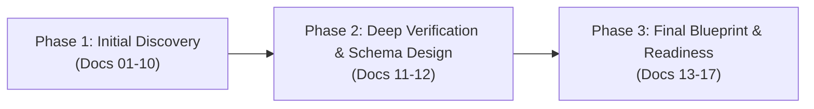

# AI Content Generation Platform: Architecture Audit & Technical Blueprint

**Author:** LCN Alvin  
**Document Version:** 3.0  
**Last Updated:** 2026-11-05  
**Document Status:** Complete Audit Suite & Implementation Blueprint  

---

## 1. Executive Summary & Purpose

This documentation suite constitutes the canonical technical audit, verified root cause analysis, and implementation-ready engineering blueprint for the Mosonic AI Content Generation Platform.

### The Investigated Problem
> **Operational Defect**: During AI content generation, the platform does not consistently follow user-provided content formats and output instructions. For example, when a user provides a structured 7-part promotional template (Headline, Intro, 4 Feature Bullets, Promotion, Persuasion, CTA, Hashtags), the system generates a general narrative paragraph instead of following the requested structure.

Through three progressive phases of technical audits, empirical testing against production code, and runtime tracing, the root failure mechanisms were isolated, verified, and resolved through an end-to-end, zero-migration architectural blueprint.

---

## 2. Audit History & Evolution



- **Phase 1: Baseline Technical Audit (Docs 01–10)**: Mapped the system architecture, inspected prompt assembly, identified initial priority conflicts, and established baseline findings.
- **Phase 2: Verification & Refinement (Docs 11–12)**: Tested regex filters empirically (proving regex does not strip section tags), traced instruction loss between the ReAct chat agent and the pipeline, designed the `InstructionContract`, and discovered the zero-migration JSONB database approach.
- **Phase 3: Final Verification & Implementation Readiness (Docs 13–17)**: Established the 5-tier prompt hierarchy, drafted complete TypeScript/Zod engineering contracts, created an actionable 8-work-package task breakdown, formulated comprehensive test suites, and codified Architecture Decision Records (ADRs).

---

## 3. Verified Core Findings & Root Causes

1. **System Prompt Constraint Inversion (CONFIRMED)**: In [`TextGenerationService.buildSystemPrompt`](../server/src/nodes/services/text-generation.service.ts), `outputFormat` defaults to `Paragraph`, injecting `=== OUTPUT FORMAT === Format: paragraph. Write in flowing paragraph form.` into the `SystemMessage`. Frontier LLMs prioritize system directives over user requests in the `HumanMessage`, intentionally flattening structured templates.
2. **Channel Adapt Node Overwriting (CONFIRMED)**: In [`AdaptNodeService`](../server/src/nodes/services/adapt-node.service.ts), downstream nodes are instructed to *"change format and length for the platform"*, rewriting structured copy into single-block captions.
3. **Chat ReAct Agent Prompt Condensation (CONFIRMED)**: The tool description in [`start-generation.tool.ts`](../server/src/rule/tools/start-generation.tool.ts) (*"What to generate this run, for example the post topic."*) cues the conversational agent model to summarize multi-section prompts into a short topic before invoking the tool.
4. **Absence of Structured Output Contracts (CONFIRMED)**: In [`LlmService`](../server/src/llm/llm.service.ts), generation uses plain text completions rather than OpenAI / Claude JSON Schema contracts (`response_format: { type: "json_schema" }`).
5. **Monolithic Data Schema & Raw Textarea UI (CONFIRMED)**: [`ContentOutputs`](../server/src/content/schemas/content.schema.ts) only models flat `text?: string`. In [`ContentDetailNodeCard.tsx`](../client/src/features/content/components/content-detail/content-detail-node-card.tsx), content is displayed in an unstyled HTML `<Textarea>` without section UI or Markdown rendering.
6. **Regex Sanitizer Behavior (CORRECTED FROM INITIAL AUDIT)**: Empirical testing proved that [`sanitizeGeneratedPostText`](../server/src/nodes/services/generated-text-guardrails.util.ts) **retains** `[Short product introduction]`, `[Key feature / benefit 1]`, and `[Call to Action – Shop Now!]` intact. It only removes bracketed directives with colons (e.g. `[Visual: ...]`, `[Image: ...]`).
7. **Zero-Migration Database Strategy (VERIFIED)**: In `server/prisma/schema.prisma`, `Content.outputs`, `Content.laneOutputs`, `Content.userEdits`, and `Pipeline.sourcePack` are already Prisma **`Json`** (`jsonb` in PostgreSQL). Storing modular section arrays requires **zero database migrations**.

---

## 4. Complete Documentation Index

### Phase 1: Baseline Architecture Audit
- **[01. System Architecture & Technical Overview](01-system-overview.md)**: Monorepo layout, NestJS backend, React SPA, BullMQ queue, and external AI models.
- **[02. AI Prompt Management & Instruction Hierarchy](02-ai-prompt-management.md)**: Prompt composition, system vs. human message priority, and the root of instruction conflict.
- **[03. AI Workflow and Orchestration](03-ai-workflow-and-orchestration.md)**: End-to-end lifecycle from Chat ReAct intake through DAG node execution, channel adaptation, and delivery.
- **[04. Content Generation and Output Structures](04-content-generation-and-output.md)**: Output structures, plain text vs. JSON schema, caption/image linking, and regeneration.
- **[05. Output Validation and Frontend Rendering](05-output-validation-and-rendering.md)**: Absence of format validators, quality checks, raw `<Textarea>` rendering analysis, and missing section controls.
- **[06. Database & API Reference](06-database-and-api-reference.md)**: Prisma entities (`Content`, `Pipeline`, `WorkflowNode`, `Rule`), API routes, payloads, and persistence flow.
- **[07. Root Cause Analysis: Loss of User Content Formats](07-root-cause-analysis.md)**: Initial root cause breakdown with code evidence and line numbers.
- **[08. Proposed Target Architecture](08-proposed-architecture.md)**: Initial 10 architectural recommendations evaluation.
- **[09. Implementation Roadmap & Migration Strategy](09-implementation-roadmap.md)**: Phased rollout plan, dependencies, and testing strategy.
- **[10. Open Questions, Technical Risks, and Decisions](10-open-questions-and-risks.md)**: Provider schema compatibility, token limits, and channel formatting constraints.

### Phase 2: Verification, Refinement & Engineering Design
- **[11. Follow-Up Audit & Architectural Decisions](11-follow-up-audit-and-architecture-decisions.md)**: Re-verification of initial findings, empirical regex test results, complete instruction lifecycle trace, and zero-migration database findings.
- **[12. Technical Design Specification](12-technical-design-specification.md)**: Engineering blueprint with proposed TypeScript interfaces (`InstructionContract`, `StructuredContentPayload`), component responsibilities, API endpoints, validation engine, and testing strategy.

### Phase 3: Final Technical Verification, Implementation Breakdown & Governance
- **[13. Final Technical Verification & Runtime Evidence](13-final-technical-verification.md)**: Final code-level verification matrix, runtime trace, and 5-tier prompt hierarchy governance.
- **[14. Final Implementation Blueprint & Engineering Contracts](14-final-implementation-blueprint.md)**: Complete target architecture, dynamic Zod schemas, pipeline sequence, and backward compatibility strategy.
- **[15. Implementation Task Breakdown & Engineering Work Packages](15-implementation-task-breakdown.md)**: 8 actionable work packages, detailed task catalog, affected files, priorities, and complexity estimates.
- **[16. Test Strategy & Acceptance Criteria](16-test-strategy-and-acceptance-criteria.md)**: Testing pyramid, unit tests, integration tests, E2E benchmarks (Instagram, LinkedIn, TikTok), and quality gates.
- **[17. Final Architecture Decisions & Engineering Governance](17-final-architecture-decisions.md)**: Formally recorded Architecture Decision Records (ADRs) and product decisions requiring sign-off.
- **[18. Final Review, Technical Clarifications & Outstanding Decisions](18-final-review-and-outstanding-decisions.md)**: Final quality review, corrected technical assumptions, provider compatibility matrix, and implementation prerequisites.
- **[19. Final Documentation Consistency Review & Implementation Governance](19-final-documentation-consistency-review.md)**: Comprehensive consistency audit, TikTok limit reality reconciliation, discriminated union specification, and multi-layer compatibility guarantees.

---

## 5. Target Architecture Summary

```mermaid
graph TD
    User["User Request"] --> Classifier["TemplateClassifierService"]
    Classifier --> Contract["InstructionContract (Stored in sourcePack)"]
    
    Contract --> TextGen["TextGenerationService<br/>(Dynamic Zod Schema with .withStructuredOutput)"]
    TextGen --> Validator["OutputValidationService"]
    Validator -->|Pass| AdaptNode["AdaptNodeService<br/>(Structure-Preserving Channel Adaptation)"]
    Validator -->|Fail (Retry <= 1)| Repair["Automated Repair Turn"]
    Repair --> Validator
    
    AdaptNode --> Persist["Content Persistence Layer"]
    Persist --> DB[("PostgreSQL Content Record (JSONB)")]
    DB --> Text["outputs.text (Compiled Markdown for Social Publishing)"]
    DB --> Sections["outputs.sections (Modular Array for Structured Editor)"]
    
    Sections --> UI["React StructuredSectionEditor"]
    Text --> Preview["Live Rich Markdown Preview Tab"]
```

---

## 6. Implementation Readiness Assessment

| Evaluation Dimension | Status | Assessment Summary |
| :--- | :--- | :--- |
| **Problem Diagnosis** | **Root Cause Identified** | Confirmed with exact code references and empirical proof. |
| **Technical Architecture** | **Architecture Proposed** | End-to-end design specified with TypeScript interfaces and JSON contracts. |
| **Database Strategy** | **Architecture Proposed** | Zero migrations required; existing `JSONB` columns fully support the model. |
| **Backward Compatibility** | **Architecture Proposed** | Dual-payload strategy (`outputs.sections` + compiled `outputs.text`) guarantees zero regression. |
| **Work Package Breakdown**| **Architecture Proposed** | 8 work packages cataloged with priorities, dependencies, and file paths. |
| **Testing Strategy** | **Architecture Proposed** | Concrete unit, integration, and E2E benchmark scenarios defined. |
| **Implementation Status** | **Implementation Pending** | Code changes have not yet been implemented in application source code. |
| **Runtime Verification** | **Runtime Verification Pending** | Final end-to-end runtime verification pending implementation of Work Package 1. |
